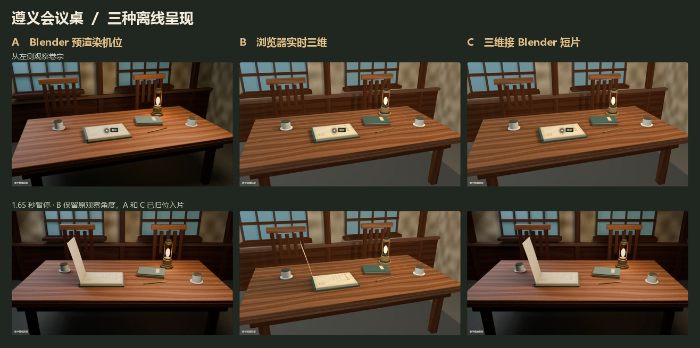

# 遵义会议桌三种呈现路线

**建议长征课以实时三维承担观察与选择，把 Blender 留给确实需要导演控制的镜头。** 这次的卷宗翻页本身适合浏览器实时绘制。若课堂还需要从自由观察进入一段事先审定的影片，则用混合路线接入。先在目标教室试这两种操作，再决定哪些段落值得渲染成片。

## 体验入口

按[复跑命令](#从源码复跑)在本目录生成以下三个 HTML。每个文件都可以单独复制到空目录，用 Edge 断网打开。先从侧面点击卷宗，翻起时暂停，再试一次拖动。点击“正面”可在相同机位比较动作和材质。教师可打开投影，把弹出窗口移到扩展屏。

| 原型 | 可实际操作 | 对制作的影响 |
| --- | --- | --- |
| `A-Blender预渲染机位.html` | 左右拖动切换 17 个实渲机位，从选定位置返回正面播放短片，支持暂停和续播。禁用 WebGL 的本机 Edge 仍能完成翻页。 | 教师机只显示图片和播放视频。新增观察角度需要补渲帧，人物或布光改动也会影响这些帧。 |
| `B-浏览器实时三维.html` | 拖动可左右绕桌、抬高或压低视角，滚轮拉近。点击卷宗，纸页网格随时间翻动。**翻到一半暂停后仍能绕看纸页。** | 几何、纹理和动作参数直接决定画面。这个版本的桌面模型与翻页可以完全用代码生成，无需用 Blender 出片。 |
| `C-三维接Blender短片.html` | 可绕桌、俯仰、拉近。点卷宗后，镜头从当前视角平滑回到标定机位，在解码首帧就绪后切入影片。片段内教师可暂停、续播，结束后恢复自由观察。 | 适合入场、人物表演等需要固定构图的关键镜头。要同时维护可绕看的场景、入片机位、灯光和影片版本。 |

完整构建还会生成 A 和 C 共用的四秒片段 `遵义会议桌-翻页镜头.mp4`。三个 HTML 各自内嵌运行素材。



## 对位怎么查

A、C 翻阅一次后打开“对位检查”。左边是**这次切换前的场景抓图**，右边是同一时刻浏览器解码出的短片起帧。拖动分界线，看书脊、桌沿和窗框会不会错开。第一次播放前也可预览锚定机位。在 C 中，接近目标角度时，压片前的 Blender 静帧按锚机位投到三维表面；离开锚点后露出的部分由实时材质绘制。单独查看“原课件参照”可比较项目已有遵义静帧与其同名影片首帧。

B 没有静帧切换到影片的步骤。“动作检查”展示同机位的静止纸页和翻起纸页，适合观察变形和遮挡。

| 实测项目 | 结果与解释 |
| --- | --- |
| 同题范围 | 同一份桌面几何、摄像机、书脊位置和翻页轨迹，4 秒内将卷宗翻起并放回。动作和场景均为教学情境示意。只比较这个物件级镜头，整堂 90 秒样段、人物表演和原会场美术仍须分别验收。 |
| 机位与片段 | A 覆盖 −32° 至 +32°、每 4° 一个机位。B/C 浏览态支持连续水平角、俯仰和距离调整。A/C 使用同一个 896 × 504、24 帧/秒、96 帧的 H.264 短片。 |
| 首帧实切 | 本机断网 Edge 分别从 −16° 和 +16° 入片。实切留样统一到相同画幅，切前画面与实际起帧的平均 RGB 通道差，A 约 **2.2/255**，C 约 **2.0/255**。色差以每通道绝对差取平均，包含压缩、采样和显示材质差异。两条路线共用同一新场景和标定机位，这组数值不能外推到任意旧图与新生成的视频。 |
| 几何校验 | Blender 独立输出各机位书脊、纸页角和桌面参照点的屏幕坐标。与浏览器相机投影比较，17 个机位上的四个定位点最大坐标差小于 0.01 像素（960 × 540）。该项验证摄像机参数；实际外观仍看上面的两帧对照。 |
| 文件与制作 | 三个独立 HTML 约为 **2.3、0.6、1.7 MiB**。A 的多机位图片占空间，B 主要携带几何与纹理，C 同时携带纹理、光照参考帧与短片。本机这次 Blender 实验用对称动作复用返程帧，渲染、编码与写盘约 **85 秒**；这个数字只适用于这组资产和设置。 |
| 设备边界 | A 在本机 Edge 禁用 WebGL 后仍可播，B/C 在该条件下会显示能力提示。三套原型均在本机断网运行；课堂实机的显卡策略、投影亮度、真人角色细节尚待现场验证。 |

三份最终文件分别放入空目录，在 Edge 157 完成 13 组验收，覆盖直接点纸面、从左右机位进入、暂停续播、自然结束、投影重连及 B 的实时动作。记录到的外部请求和页面脚本错误均为 0。[可复跑的验收脚本](../../Test/verify-shot-routes.py)

**路线取舍。** 简单物件动作先用 B，可以直接调整动作并允许学员边看边转。需要电影化表演、且镜头期间不要求自由绕看时，沿用 C。章节内容和机位都已审定、教学机图形能力不可靠时，交付 A 作兼容版本。正式使用甲方选定的演示截图时，应先将该图定为基准，再制作并叠验对应镜头；实验模型的对位成绩只针对本轮会议桌。

## 从源码复跑

源码在 [镜头路线实验](../../课堂演示/镜头路线实验/)。从仓库根目录执行以下命令。开发机需要 Python、Pillow、NumPy 和 FFmpeg；A/C 的素材生产使用 Blender 4.5。打开交付文件的教室电脑无需这些制作工具。

```powershell
python -B "课堂演示/镜头路线实验/make_scene.py"
python -B "课堂演示/镜头路线实验/build.py" --only B
& ".march-build/blender-4.5.4-windows-x64/blender.exe" -b --factory-startup --python-exit-code 1 -P "课堂演示/镜头路线实验/blender/render.py" -- --scene ".march-build/route-lab/scene.json" --assets ".march-build/route-lab" --out ".march-build/route-lab/media"
python -B "课堂演示/镜头路线实验/build.py"
python -B "Test/verify-shot-routes.py"
```

前两步可单独生成 B。A/C 的中间帧放在本地构建目录，构建器只把当前路线运行所需的资源内嵌到对应 HTML。实时绘制使用浏览器 WebGL；Blender 路线先渲染静帧序列再编码。[WebGL 官方说明](https://www.khronos.org/webgl/) · [Blender 4.5 动画渲染手册](https://docs.blender.org/manual/id/4.5/render/output/animation.html)
