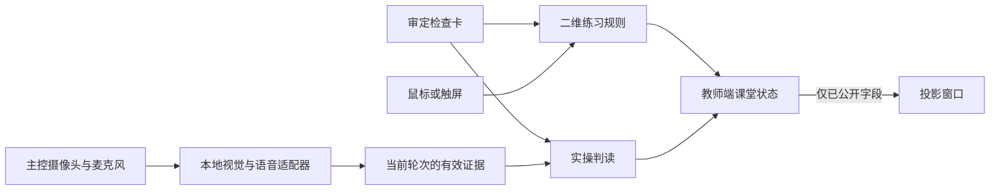

# 五点式安全带实训课｜架构与技术选型

> 2026 年 11 月 26 日，甲方取消五点式安全带实训课。本文保留取消前的记录，供查阅。

2026 年 11 月 24 日，设计稿 v0.1。本轮交付架构、选型和验证设计。课件实现、设备采集和模型训练属于后续工作。37 秒视频已演示“选错视角、提示、重试”的教学构想。公开器具图可用于介绍片，正式穿戴规则要绑定具体教具和教师审定的检查卡。[需求及评分对照](五点式安全带课需求梳理.md) · [现有视频和素材](<分镜与素材.md>)

## 课堂上如何使用

1. 教师在 Edge 打开安全带课的独立 HTML，可以单屏授课或打开投影。学员先切换示意图正背面，指出指定部件。
2. 学员拖动部件，或先点部件再点位置。错放时带体和已完成步骤留在原位，正确时两者一起更新。在查错场景中，学员可以撤销、重做，对照两种状态。导学可揭示做法，独立练习只给当前任务和必要的纠错提示。评价显示首次尝试、完成和仍需练习的项目。
3. 教师主动进入地面实物练习，选择同型号检查卡的一项可见外观和一个中文必讲要点。教师端分别请求摄像头、麦克风授权。可见偏差经确认后才给外观提醒；口述结束、收音可辨且内容足够判断时才给补讲提示。
4. 学员重新展示或补讲。教师结合实物复核并决定何时向投影揭示反馈。设备失效时可继续二维教学，或把相应实物项目切到教师判读。给学员的结果限定到本次观察项。

## 架构决策

**采用独立课程入口、一份版本化检查卡、教师端单一写入、投影接收完整公开快照。** 二维状态与真人观察轮次各自管理。开发工具沿用仓库已有的 Node.js 22.21.0、TypeScript 5.9.3、esbuild 0.25.11 作为起点。安全带使用独立入口和资源清单；构建时复用已验证适合两课的逻辑。长征现有授课全局状态和三维运行时属于长征课。[现有构建](<../../../课堂演示/build.mjs>) · [已用工具版本](<../../../课堂演示/自由探索实验/package.json>) · [既有双屏配对](https://github.com/glyahh/VR-Teaching/blob/codex/teacher-prep-archive/课堂演示/src/presenter.ts)

### 数据和模块边界

以下为拟建模块；函数名用于明确调用方能做什么。

拟以 `课堂演示/安全带实训/` 作为独立制作目录。入口装配 `card`（检查卡）、`practice`（二维练习）、`attempt`（真人轮次与判读）、`projection`（双屏）和两路观察适配器，资源清单与构建脚本归本课持有。根目录 `Test/` 放规则夹具和 Edge 操作脚本，课件资产只收运行所需文件。此目录布局为实施建议。

| 模块 | 输入、输出和唯一写入者 |
| --- | --- |
| 检查卡与运行资源 | 每张卡有型号、版本和审定依据。每项定义稳定 ID、学习目标、前置步骤、允许的目标、对应 SVG 部件、相关危险提示及评价依据。真人项另定义可见条件、可接受的口述表达、纠正语和教师触检项。构建时检查重复 ID、前置环路、缺图层和缺依据。每轮固定卡版本。 |
| 二维练习 | 视图处理指针捕获、坐标换算和拖动预览；规则接收一次已完成的操作意图，原子更新步序和带体。松手、点目标和键盘确认可共用同一入口。取消拖动、丢失指针或离页时丢弃临时预览。错放保留原步，重复提交同一意图只记一次。 |
| 实操会话 | 教师端拥有设备和当前轮次。采集时就标记轮次、检查项、通道代次和采样序号。收到异步结果后先校验归属，再更新该通道证据。同一轮重新展示，也会使先前观察失效。 |
| 判读与复核 | 根据当前卡和已接收证据产生外观提示、口述提示或待核原因。两路结果独立保留，界面一次显示一句。两路均有明确问题时先处理可见外观，再处理口述。被遮挡或收音不清时请学员重新展示或重说。教师手工复核后，迟到模型结果不能覆盖同次复核。 |
| 双屏 | 教师端将当前可公开内容投影成白名单结构，包括课程页面、示意图状态、已公开材料和教师主动揭示的反馈。投影只负责渲染和就绪通知。摄像头原始帧、音频、完整转写、待揭示答案和推理中间量留在主控。 |
| 打包 | 独立构建清单列出脚本、SVG、样图、卡、可选模型、加载器、WASM 及许可。构建生成一个 HTML 和本地核验用的成品哈希；模型仅在对应模块通过验证后进入发布清单。测试和训练数据放在运行包之外。 |

二维操作可按 `applyPracticeAction(card, state, action) → result` 实现。撤销恢复上次已提交的步号和图层位置，改拖后清空重做分支。尝试记录与可撤销的带体状态分开，首次错放在复盘时仍可见。学员随时可以结束本轮查看评价；必经步骤缺失时列出待练项及依据，全部达成才显示本轮完成。重复提交得到同一结果，提交后再练开新轮次。

真人端的最小调用为 `startAttempt(card, item)`、`finishExplanation(attempt)`、`endAttempt(attempt)`。会话从“等待授权”进入“观察中”，口述可以独立进入“等待最终转写”，随后等待教师复核。换人或离场使整轮失效；离框或重说使对应通道代次失效。新代次允许接收新证据。点结束时关闭本次口述输入，异步解码在结束前采入的最后一段音频。若超过目标机试讲确定的等待预算、断麦或教师提前接手，则递增语音代次，提示重说或由教师记录，迟到终稿直接丢弃。视觉仍可工作。权限弹窗迟迟没回应时，教师可以退出；已退出后才获准的流立即停止。断开一路设备时只撤销该路，双路不可用则转人工。离场停止所有轨道与音频节点，关闭推理任务并释放模型、缓冲和临时 URL。

| 边界 | 接受的数据 | 要防止的错例 |
| --- | --- | --- |
| 观察结果进入会话 | `{ attemptId, itemId, channel, generation, sequence, finding }`。外观区分待观察、证据不足、参考外观一致、可见偏差。口述区分讲述中、已结束待结果、听不清、要点已表达、明确缺项。 | 同轮离框又回来，老画面的“一致”迟到；换人后上一人的转写返回；说“还没检查”被关键词命中为已完成。 |
| 主控发送给配对投影 | `{ session, revision, publicView }`。核对窗口来源和本次配对令牌，同会话只接受更新版本。投影打开或刷新后握手，主控立即发完整快照。 | 关闭投影期间主控继续授课，重开后仍显示旧页；撤回公开内容后，旧消息让它重新出现。 |
| 课堂记录 | 默认留在本次主控会话内，含卡版本、检查项、首次尝试、纠正和教师复核结果。换卡开启新轮次，已生成摘要保留原版本。主控刷新结束本次会话，投影清除旧画面并重新配对。 | 按新版卡重算旧评价，或让上一名学员的反馈留在下一轮。 |

主控刷新和投影刷新要分别设计。投影在主控正常时能恢复公开内容；主控意外关闭时，投影应通过窗口存活检查或心跳过期清屏。公开输出建议收敛为 `publicView(teacherState) → PracticeView | ObservationView`。投影就绪时与当前主控握手，握手完成前显示等待画面。换人、换项或已公开的反馈失效时，主控立即清除对应公开字段、发布新版本，避免另一名学员看到上一轮结果。单文件里含课程资料，这里的公开边界约束课堂界面、同步消息与采集数据。

## 技术选型和替代条件

| 能力 | 首选 | 切换条件与代价 |
| --- | --- | --- |
| 二维练习 | 原生 TypeScript、DOM、分层 SVG 和 Pointer Events。检查卡引用图层，鼠标和触屏走同一判定。 | 只有审定项目确实需要额外视角才补同型号局部图，再论证局部三维。整套三维会扩大建模和教室 GPU 验收范围。H5P 分支课程可参考错后重试的教学节奏，引入其播放器将增加独立打包和状态对接。 |
| 状态同步 | 主控持有分开的练习、观察和公开状态，用原生窗口与 `postMessage` 配对，只发最新完整公开快照。 | 全量事件回放便于审计，但需定义撤销和迟到识别事件的重放语义。单屏、投影重开及当前课堂复盘用快照和逐项摘要即可。 |
| 视觉 | 固定机位保留目标部位与躯干的位置关系；仅在能稳定看清时判一项外观。先以教师标注或简单几何线索作基线，再比较同型号小样微调的 MobileNetV3-Small。训练在开发机完成，导出 ONNX，课堂首测 ORT Web 单线程 WASM。 | 预训练权重用于迁移学习。通用“有穿／没穿”模型只能提供外观存在的线索。若固定取景下仍无法区分手持、遮挡和真实偏差，则转教师判读。需要进一步采样或定位模型时，用错例证明必要性。 |
| 中文口述 | 优先验证 sherpa-onnx WASM + 中文 14M Zipformer 流式转写，学员结束后才用审定表达、否定和可辨性规则判读。只判断一个必讲项。 | 用同一组口述比较较大的中英 Paraformer。小模型若易混淆关键术语，大模型只有在目标机的正确性、延迟和内存均可接受时才入选。只有关键词命中、音频中断或存在歧义时保留待核。 |
| 设备与执行 | 主控用 `getUserMedia` 分路请求，真人段按需创建本地推理 Worker。视觉最多一个在途任务，繁忙时只保留最新待处理帧；音频按顺序送入，缺帧或队列溢出应标为证据不足。 | 设备被占用、权限被拒或推理崩溃时，该路切换为教师判读，二维页和另一通道可以继续。再次启用须由教师主动触发。 |
| 发布 | 开发期间可用本地服务器调试。交付优先从空目录直接打开独立 HTML。按实际依赖内嵌字节，解包后按需初始化。 | 本地服务是改变交付形态的备选。仅在自动反馈确属必交、且确认阻断来自可由同源服务解决的加载或策略限制时才提请变更，另计端口、启动和运维。服务无法修复模型误判。 |

**语音包体会改变首选顺序。** 上游固定版本目录显示，中文 14M Zipformer 的 INT8 编码器、解码器和 joiner 合计 **25,305,928 字节**；中英 Paraformer 的两个 INT8 权重合计 **237,126,745 字节**。两数均为权重文件大小，未含词表、运行时及封装开销。打包后大小和峰值内存须另测。WASM 识别器的模型类型、导出图、词表和运行时须成套锁定；上游网页示例跑通也仍需验证本课的离线加载和语音表现。[中文模型文件与版本](https://huggingface.co/csukuangfj/sherpa-onnx-streaming-zipformer-zh-14M-2023-02-23/tree/204ad334e2e683fd295359930cc16fc0432a23ac) · [对照模型文件与版本](https://huggingface.co/csukuangfj/sherpa-onnx-streaming-paraformer-bilingual-zh-en/tree/8e40c43232a1c5c66c82111efc5820d3accca11b) · [上游 WASM 资源准备](https://github.com/k2-fsa/sherpa-onnx/blob/master/wasm/asr/assets/README.md)

**单文件要在真实入口验证。** ORT Web 可设 `numThreads = 1`，多线程需要浏览器支持和跨源隔离。sherpa 使用自己的 WASM 构建，须单独核对线程要求及其 JS、WASM、模型数据加载方式。优先试从内嵌资源初始化单线程运行时，按需要给自包含 Worker 和加载器提供本地 Blob URL 或内存文件。正式件中相邻路径、隐式 CDN、跨源隔离、模型的二次加载和多份运行时占用，均列为冷启动验证项。浏览器允许在安全上下文申请设备，实际 `file://` 行为受目标 Edge、设备和单位策略影响。[ORT 部署](https://onnxruntime.ai/docs/tutorials/web/deploy.html) · [ORT 线程设置](https://onnxruntime.ai/docs/tutorials/web/env-flags-and-session-options.html) · [浏览器采集条件](https://developer.mozilla.org/en-US/docs/Web/API/MediaDevices/getUserMedia) · [MobileNetV3-Small](https://docs.pytorch.org/vision/stable/models/generated/torchvision.models.mobilenet_v3_small.html)

资源清单随候选件锁定工具链、JS/WASM 配对版本、各模型修订号、字节数、SHA-256、许可和检查卡版本。更新时先生成临时 HTML，清点资源并校验后替换成品，保留上一个通过验收的版本。课堂预检可以用固定输入验证加载器与模型的接线；教员的真人样本用于验证实际判断。切到教师判读时，界面和结果记录注明判断来源；若用户确认自动反馈是必交项，人工接续只能保障课堂继续，该自动项仍标为待解决。

**目标机放行条件。** 确定试讲电脑后，技术侧先记录可用内存、空载与纯二维双窗基线，并按真实课堂停顿给冷启动和结束口述后的等待设预算。记录阈值、测量方法及可用的内存余量，再比较两个语音候选。在同机同输入下分别测冷启、两路同时运行、退出重进；发现外联、超出预算、UI 无法操作、设备持续占用或本项盲测失败，就把自动模块留在待验证状态。包体数据来自目录元信息，整机性能以成品测量为准。

## 获准实施后的验证顺序

| 验证切片 | 输入与操作 | 通过依据、失败处理 |
| --- | --- | --- |
| 1 · 二维规则与真实入口（B-01、B-04） | 用一张审定检查卡做一个完整步骤。鼠标拖错、改对、撤销、改拖、提交；触屏和点选复跑。试漏做前置步骤、双次提交和换卡。 | 步号与图层一起回退，重做分支正确失效，错项可重练，结果仍绑定原卡。二维入口零采集权限。保留规则测试和断网 Edge 成品操作。通过后再扩展三类练习。 |
| 2 · 单文件和投影（B-03） | 候选 HTML 独自复制到空目录，断网冷启两窗。练习时重开投影、先后揭示和收回材料，模拟过期快照。分别测普通启动和启用观察后的峰值内存、帧卡顿、入场等待。 | 零 HTTP(S) 请求；关闭投影后主控可用，重连只恢复当前公开字段。检查空目录、实际尺寸、版本、哈希、权限提示和报错。设备权限与模型加载失败均可退出或转人工。 |
| 3 · 真人可行性（B-02、B-03） | 拿到同型号教具、老师审定的样本和目标机后，分别测试视觉与语音，再并发。注入离框重进、重说、换人、晚授权、拔插、听不清、否定和连续两条问题。 | 待判不自动记对或记错，旧回调无法清除新提示，教师复核能接续。摄像头、麦克风在离场后释放。若自动项表现不足，保留真实失败样例及教师判读路线。 |
| 4 · 盲测和内容回归（B-02、B-05） | 样本按人和拍摄批次分开训练、调参与盲测，教师先独立标注。沿用原案建议：6 名独立学员各做正常、明显偏差、手持、遮挡，共 24 次；口述另测完整、漏讲、同义、否定、噪声与录音不全。 | 建议正常和偏差分别至少 5/6 正确，12 次手持／遮挡均不提示一致；站稳到提示以 2 秒为试讲观察目标，分别记录误纠正、漏纠正、弃判、延迟及分母。口述检查否定误通过和听不清误判漏讲。换版本后按同一审定口径重测。阈值是试讲建议，结果待实测。 |

证据随检查卡版本、模型及许可、课件哈希、设备和 Edge 版本一起记录。现有历史文档记载模拟采集和数值模型离线推理，但没有真实同型号识别与否定句判读的验收结果。程序设计和工程选型可据此评审，自动识别能力以目标机盲测为准。[既有实测范围](../两门参赛课程技术实施方案.md#首轮投入与实测依据) · [项目验收映射](<../../长征课/SDD-TDD.md#验收测试与证据映射>)

本轮四路 `high` 候选与一轮独立 `high` 复核均已完成。采用分开管理练习和观察状态的方案，吸收了版本化检查卡、成品预检及按人分组盲测的设计。复核后明确了漏步仍可结束并查看评价、语音终稿超时的回退，以及单文件的目标机放行条件。
