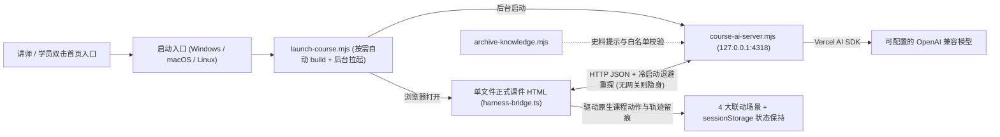

# 长征课《从于都到遵义》AI 智能体架构与功能设计

本文记录《从于都到遵义》的三项 AI 教学功能。当前实现使用 Node 课堂网关和 Vercel AI SDK，推理服务可通过本机配置替换。总课程交付边界见[冻结落地方案](长征沉浸式VR党课落地方案.md)和[离线架构设计](长征课离线架构设计.md)。

---

## 1. 背景、甲方需求与设计红线

### 1.1 受众与参赛定位

- **参赛类别**：第二类「数字化实训课」（聚焦真实问题求解、可操作交互与实训留痕闭环，非纯知识宣讲视频）。
- **核心受众**：30 岁左右的国网电力一线员工与业务骨干（电网调度、特高压运维、配网抢修、班组管理）。该群体习惯“条件约束—风险推演—依据查证—机制落地”的工作思维，反感低幼化填空题、口号式说教与“伪智能”表单。
- **访谈依据**（详见[冻结落地方案 · 访谈背景](长征沉浸式VR党课落地方案.md#访谈背景)）：面向 AI 赋能现场教学，打磨“现场互动、选项、情节与走向”，强调先看实际操作效果，再深化教学内容。

### 1.2 五条工程与体验红线

1. **绝不做关键词伪 AI**：禁止以本地关键词匹配/正则规则加输入框充当“AI 对话”（用户随意输入无意义字符如 `123` 时会当场穿帮并破坏沉浸感）。
2. **纯离线零请求零残留**：直接打开离线 HTML 时跳过网关探测并隐藏 AI 入口。一键开课会附上网关地址，课件连通后才启用 AI。练习面板保留成人决策选项与史料核对。
3. 教学界面展示角色与任务名称。模型名称和开发框架留在网关配置及调试信息里。
4. **党史口径严格受控**：反事实推演与复盘简报均受内置权威事实库（[archive-knowledge.mjs](../../课堂演示/harness/archive-knowledge.mjs)）约束，禁止编造档案编号，推演结论强制对照并收束回历史真实抉择。
5. **单屏极简与不遮挡主体**：交互抽屉紧贴右上工具栏下方或既有边缘控件区展开，不遮挡中央地形、黎平舆图按钮组、3D 会议桌交互物件与左下讲述框。

---

## 2. 技术选型与总体架构

### 2.1 技术选型对比

| 方案路线 | 现场算力依赖 | 教学交互上限 | 党史可控性 | 综合评价 |
| --- | --- | --- | --- | --- |
| 本地关键词/规则匹配 | 无 | 极低（输入 `123` 即穿帮，无推演与控场能力） | 静态写死 | **否决**：拉低品相且无法应对现场真实追问 |
| 讲课电脑纯本地运行大模型 | 极高（依赖现场显卡） | 中等 | 取决于提示词 | **否决**：现场办公机算力不可控，极易卡顿崩溃 |
| 前端直连裸 Chat API | 无 | 较低（只能纯文本一问一答，无法驱动 3D/切页/归档） | 无工具校验，易产生幻觉 | **淘汰**：难以体现“数字化实训”交互深度 |
| **Node 课堂网关 + Vercel AI SDK（当前方案）** | 教室电脑播放课件，模型可部署在云端或内网主机 | 模型输出 JSON，课件执行控场、SVG 推演和三维动作 | 网关校验输出结构及动作 | 四个接口共用可配置的推理端点 |

### 2.2 系统架构



### 2.3 浏览器沙箱边界与跨电脑一键复用机制

- **为什么不能仅靠纯 `.html` 文件自启动后台进程**：现代浏览器（Edge/Chrome）安全沙箱严禁 `file://` 或本地网页 JavaScript 私自执行系统 `.exe` 或 `node` 进程。
- **跨电脑启动方式**：
  - 将按操作系统区分的入口集中放置在仓库根目录[启动入口/](../../启动入口/AGENTS.md)，全部采用相对路径动态查找（Windows 入口 `.vbs` / `.cmd` 采用纯 ASCII + CRLF 编码，遍历定位 `harness\launch-course.mjs`，规避任意盘符硬编码与中文区域编码兼容问题）。
  - 装好网关依赖并配置模型后，[launch-course.mjs](../../课堂演示/harness/launch-course.mjs) 按需构建正式 HTML，后台启动本机网关，并打开课件。
  - 课件根据启动地址探测网关并显示 AI 入口。直接打开 HTML 时跳过探测。上游模型断网会在已打开的 AI 功能里显示重试提示。

---

## 3. 已落地 4 大 AI 智能体功能规格

| 功能模块 | 前端触发入口 | 后端端点 | 结构化协议核心字段 | 前端联动与实际教学效果 | 核心源码 |
| --- | --- | --- | --- | --- | --- |
| **① 行迹副导** | 正课右上工具栏「行迹副导」 | `POST /api/course-ai/director` | `narration`、`actions[]` | 在圆角浮层输入多行文字。网关流式返回回复和处理状态，讲师在校验后的动作卡上确认切页、路线对照、高亮热点、打开材料或进入回顾。确认切页后可在目标页看见短讲述。 | [harness-bridge.ts](../../课堂演示/src/harness-bridge.ts)<br>[lesson-page.ts](../../课堂演示/src/lesson-page.ts) |
| **② 1934 战地推演沙盘** | 黎平「进军方向」桌面按钮组「沙盘推演」 | `POST /api/course-ai/sandbox` | `trajectory`、`riskLevel`、`mapPath`、`chokePoint`、`telegramTitle`、`battlefieldOutcome`、`historicalContrast` | 面向 1934 年 12 月渡江后仅余 3 万余人与湘西北口袋阵约束：学员输入假设方案（如“强攻湘西北”或“分兵牵制”），前端在黎平桌面舆图 SVG 上**绘制红色假设推演轨迹与敌军阻击区脉动圆环**，右侧展示带「假设推演 · 非真实史实」标识的密电后果与历史对照，并一键「对照真实历史抉择 · 转向黔北」无缝复位。独立 3D 沙盘与 AI 原生多路推演的演进规划见[黎平 3D 沙盘推演开发方案](黎平3D沙盘推演-SDD-TDD-pstack开发方案.md)。 | [harness-bridge.ts](../../课堂演示/src/harness-bridge.ts)<br>[lesson-page.ts](../../课堂演示/src/lesson-page.ts) |
| **③ 课尾「千班千面」实训复盘简报** | 「课堂回顾」底栏「实训复盘简报」 | `POST /api/course-ai/recap-report` | `title`、`subtitle`、`executiveSummary`、`journeyHighlights[]`、`decisionComparison`、`gridMapping[]`、`discussionQuestions[]` | 汇聚本场课堂状态、关键原始事件和纠错过程，结合所选岗位及可选班组难题，生成复盘简报和岗位映射卡。讲师可导出独立单页 HTML。 | [course-context.mjs](../../课堂演示/harness/course-context.mjs)<br>[harness-bridge.ts](../../课堂演示/src/harness-bridge.ts)<br>[recap-stage.ts](../../课堂演示/src/recap-stage.ts) |

---

## 4. 安全裁剪与党史口径治理

### 课堂上下文规格

同一标签页的一堂课使用一个会话 ID。原始事件采用追加写入，通过会话 ID、事件 ID、顺序号及交互关联 ID 查询。课件维护当前场景、材料阅读、原题和活动状态。网关使用 SQLite 保留同步后的事件及按入口生成的摘要。两端分批同步，原始事件及实际操作结果可独立核对。

四个入口各选相关交互，共用输入预算。完整保留六条课程事实、规则、动作白名单、输出结构、当前输入和课堂当前状态。先按事件关联和状态去重，再保留近期完整交互及早期纠错。剩余旧交互超预算时可用同一兼容端点生成增量摘要，引用事件及证据 ID，摘要随用户消息传入。超时、无收益、格式异常或关闭摘要时改用确定性选择。受保护内容超预算时报错。重新开课更换会话 ID，旧版缺失状态按未知处理。

1. 模型调用只提交提示和输出结构。场景切换和材料打开由课件执行。
2. **结构化输出 + 双重白名单防幻觉**：
   - AI SDK 默认使用 JSON 对象模式解析结果。端点支持原生 JSON Schema 时可配置 `Output.object()`，兼容模式允许可选字段。网关按各课堂接口的约定校验字段。
   - `sanitizeDirectorActions()` 仅放行预设的 6 类课件动作。课页、热点、档案和桌面物件分别匹配各自的白名单。
   - 生成内容以课程事实库为边界，围绕当前教学任务呈现。
3. **异常诚实透传与状态隔离**：
   - 网关将额度不足、权限问题、连接异常和响应超时转换为可重试的课堂提示。每次生成接收当次所需的课堂上下文。
   - 副导仍可读取已保存的聊天文字。课堂事实、状态和原始事件分别装配。已阅桌面材料跨课页及刷新恢复。会场质询已撤下，已有交互记录留在原课堂。
   - 重新开课切换课堂 ID。网关中的旧事件及摘要按旧 ID 保存，仍可用原事件 ID 核对。浏览器快照失败后保留当前内存，SQLite 写入失败后从浏览器批次重传。
4. **本地凭据安全**：
   模型密钥保存在本机配置或环境变量，配置与日志由 [.gitignore](../../.gitignore) 排除。网关监听回环地址。配置上游密钥时，启动器为课件附上本地访问凭据。

---

## 5. 跨电脑复用部署与模型切换指南

### 5.1 新电脑一键启动（无需改动代码）

- **Windows**：双击 [启动入口/Windows/一键开课.vbs](../../启动入口/Windows/一键开课.vbs)（无黑框后台拉起服务并开课）或 [启动-从于都到遵义.cmd](../../启动入口/Windows/启动-从于都到遵义.cmd)。
- **macOS**：双击 [启动入口/macOS/启动-从于都到遵义.command](../../启动入口/macOS/启动-从于都到遵义.command)。
- **Linux**：运行 [启动入口/Linux/启动-从于都到遵义.sh](../../启动入口/Linux/启动-从于都到遵义.sh)。

首次配置 AI 时安装网关依赖并填写本机模型配置。详见[课堂 AI 网关说明](../../课堂演示/harness/README.md)。

### 5.2 切换模型或对接公司主机

复制 [course-ai.config.example.json](../../课堂演示/harness/course-ai.config.example.json) 为 `课堂演示/harness/course-ai.config.json`。填写上游的 API 基址、模型 ID 和所需密钥，重启网关后通过一键开课进入。更换供应商后用真实端点逐项验收，确认 JSON 输出、请求取消和错误提示。

---

## 6. 源码清单与自动化验收门禁

### 6.1 关联文件清单

| 模块 | 文件 | 职责 |
| --- | --- | --- |
| 一键启动与网关 | [启动入口/AGENTS.md](../../启动入口/AGENTS.md) | Windows / macOS / Linux 跨平台相对路径启动入口 |
| 启动器与服务 | [launch-course.mjs](../../课堂演示/harness/launch-course.mjs)<br>[course-ai-server.mjs](../../课堂演示/harness/course-ai-server.mjs) | 后台启动、模型接入和结构化接口 |
| 知识与安全白名单 | [archive-knowledge.mjs](../../课堂演示/harness/archive-knowledge.mjs) | 课程事实与动作白名单 |
| 前端联动与样式 | [harness-bridge.ts](../../课堂演示/src/harness-bridge.ts)<br>[style.css](../../课堂演示/src/style.css) | 退避重探、三项课堂 AI 交互、HTML 归档导出 |
| 宿主场景与会话 | [lesson-page.ts](../../课堂演示/src/lesson-page.ts)<br>[desk-player.ts](../../课堂演示/src/desk-player.ts)<br>[recap-stage.ts](../../课堂演示/src/recap-stage.ts)<br>[lesson-session.ts](../../课堂演示/src/lesson-session.ts)<br>[app.ts](../../课堂演示/src/app.ts) | 场景控制钩子、黎平双线/沙盘挂载、遵义 3D 光影联动、轨迹持久化 |

### 6.2 自动化验收命令与校验口径

```powershell
# 1. 构建单文件离线课件并验证一致性与策略门禁
node "课堂演示/build.mjs"
node "课堂演示/build.mjs" --check
node "Test/verify-presentation-policy.mjs"

# 2. 网关模型适配、错误映射、白名单和一键开课
node "Test/verify-course-ai.mjs"

# 3. 真实离线 Edge 双态端到端验收（纯离线 0 请求 + 连接伴随网关全流程 + UI 位置与零重叠几何校验）
.\.march-build\project-audit-venv\Scripts\python.exe "Test\verify-harness-e2e.py"
.\.march-build\project-audit-venv\Scripts\python.exe "Test\verify-harness-e2e.py" --live
```

- Edge 报告及截图写入 `.march-build/verify-course-ai-edge/`。`--live` 使用真实模型并写入 `.march-build/verify-course-ai-edge-live/`。
