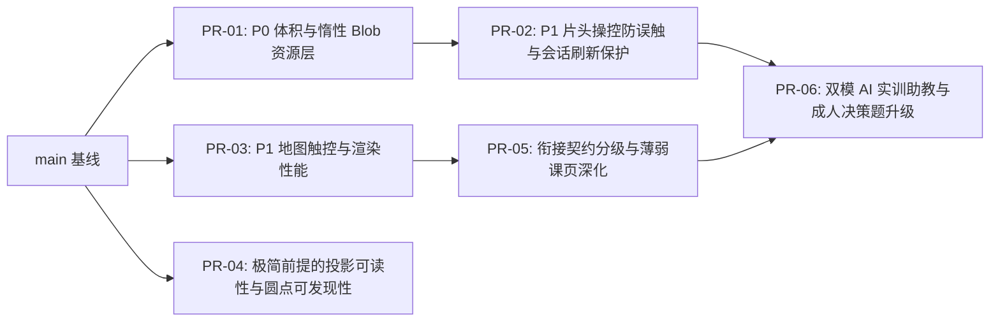

# 长征课《从于都到遵义》专项优化 SDD + TDD + pstack 开发方案

- **版本**：v1.3（2026-11-27）。PR-06 的当前实现采用 Node 课堂网关、Vercel AI SDK 和可替换的模型端点，沿用四项课页联动。旧版离线关键词与 OpenCode 方案按历史记录阅读。现行规格见[长征课 AI 智能体架构与功能设计](长征课AI智能体架构与功能设计.md)。
- **适用范围**：长征课《从于都到遵义》（第五届电力行业数字化教学技能竞赛第二类「数字化实训课」，受众为 30 岁左右国网电力员工）
- **执行模式**：本文件为 **实施前蓝图（Plan Deliverable）**，遵循 pstack `multi-phase-plan` 规范；**仅交付规格、契约、TDD 闭环与分 PR 验收清单，待操作者明确确认后按 PR 顺序启动编码**。

---

## 0. 已确认的需求裁决与红线约束

本方案只解决以下已确认问题，严守不扩大范围、不破坏现有已通过验收路径的原则：

| 议题 | 裁决结论 | 设计红线 |
| --- | --- | --- |
| 授课形态 | **维持纯单屏** | 不恢复双屏或常驻教师副屏，不在主画面新增教师提词栏或后台控制面板。 |
| 极简与物理可读性 | **极简优先前提下微调** | 严守 [长征课 UI 背景与状态规范](../规范/长征课%20UI%20背景与状态规范.md) 的底色与零冗余文案红线；只用无文字视觉手段提升投影对比度与 13px 圆点可发现性。 |
| 课堂运行态 AI 赋能 | **离线优先、多级自适应 AI 架构** | 现场电脑可能无独立 GPU 且可能断网，**绝不把 AI 赋能绑定在“现场自部署本地小模型”上**；默认采用「构建期 AI 蒸馏语义诊断 + 史料证据链推理 + 过程性决策画像复盘」（纯浏览器、零 GPU、100% 离线毫秒级响应），同时保留可选标准 API 适配器（可直连公司主机自部署模型或有网环境下的云端/内网 LLM），超时或断网无感回落离线底座。 |
| 首尾帧衔接与薄弱课页 | **衔接分级去内耗 + 深化薄弱页** | 区分同机位无缝硬切（继续守 `< 3/255`）与跨景别叙事转场（改用柔和叠化与连贯性验收），停止无意义 AI 补镜内耗；将精力集中于深化猴场、乌江、遵义军事与组织课页及成人实训深度。 |
| 前端 P0 / P1 治理 | **不动片头画质，纯前端架构提速** | **保留现有 `opening.mp4` 画质与配音不重编**；P0 聚焦将大视频/音频/GLB 移出同步 `<script>` 改用惰性容器 + `Blob URL` 按需租约与离页释放；P1 落实片头 `Space` 暂停 / `Arrow` 快进退 5 秒 / 静音同步 / 时码提示、地图保持“桌面端默认旋转 + 补触控双指缩放平移”与 `rAF` 合帧、后台 `rAF` 挂起、`sessionStorage` 防误刷新。 |

### Antigravity × pstack 运行规则（强制）

本仓库在 Antigravity 环境中执行 pstack 流程，所有任务与子代理均须遵守 `pstack-harness-adapter`：

1. **先读适配层与工作规约**：每个子代理的启动提示词首行必须写入：
   `Read C:\Users\gyb10\.gemini\config\plugins\pstack\skills\poteto-mode\worker.md and C:\Users\gyb10\.gemini\config\plugins\pstack\skills\pstack-harness-adapter\SKILL.md before anything else.`
2. **原生角色与思考档位**：使用原生 `invoke_subagent`，按角色选用 `poteto-agent`（实现与重构）、`pstack-researcher`（只读侦查）、`pstack-reviewer` / `pstack-reviewer-alt`（对抗审查与验收复核）、`comment-sicko`（提交前注释审查）；按 [仓库指南](../../AGENTS.md) 显式要求高思考强度（`high` 或更高），且不把同模型双席伪称为跨模型面板。
3. **隔离与审批边界**：仅对文件范围互不重叠的独立 PR 使用 `Workspace: "branch"` 并行；合回前先抽回补丁并复验，不擅自 `git push`、合并或删除用户已有改动。
4. **过程留痕**：长链路或跨 PR 实施启用 `/show-me-your-work`，将决策日志保存在 `.march-build/sdd-tdd-pstack/decisions.tsv`。

---

## 第一层｜SDD 需求规格与白话验收（What & Why）

承接 [SDD-TDD.md](SDD-TDD.md) 既有编号 `R-01`–`R-15` 与 `M-01`–`M-06`，本轮新增规格如下：

### 1.1 新增与修订需求清单

| 需求 ID | 来源与目标 | 核心规格 | 所属 PR |
| --- | --- | --- | --- |
| **R-16** | P0 加载与内存治理（保原片画质） | **不重编、不降质现有 `opening.mp4`**；主 `<script>` 同步 JS 解析量由 173 MB 降至 `< 20 MB`；所有 `> 512 KB` 视频、音频与 GLB 改用 `<script type="text/plain" data-asset>` 惰性容器按需解码为 `Blob URL`，离页彻底卸载 `src` 并 `revokeObjectURL`。 | PR-01 |
| **R-17** | P1 课堂操控防误触与稳健性 | 片头页支持 `Space` 暂停/续播、`ArrowLeft/Right` 快退/快进 5 秒（不再一键跳过全片）、顶部补齐与全局联动的静音键、进度条悬停显示时码与站名；课堂进度接入容错 `sessionStorage` 防误按 `F5` 丢进度（点「开始授课」重置）。 | PR-02 |
| **R-18** | P1 渲染性能与触控手感 | 首页地图桌面端**保持“默认左键旋转、Shift 平移”不变**，补齐触控端双指捏合缩放和平移；`pointermove` 改 `rAF` 合帧与合成层定位；`cinemagraph` 与 `desk-live-session` 后台标签页彻底挂起 `rAF`；`page-entry` 收缩全局 `MutationObserver`；地形改为按需初始化并关闭常驻 `preserveDrawingBuffer`。 | PR-03 |
| **R-19** | 极简前提的教室投影可读性 | **不增说明文字、不改 `.copy-panel` 10% 底色规范**；在亮背景场景增强底部微托暗角渐变（`--scene-edge-shade`）；为 13px 无文字场内圆点增加极轻周期微光呼吸与高对比描边（`prefers-reduced-motion` 下静默保留清晰环边）；补全跨浏览器进度条伪元素样式。 | PR-04 |
| **R-20** | 衔接契约分级与薄弱课页深化 | 将视频首尾帧契约分为 **A 级无缝同机位硬切（RGB `< 3/255`）** 与 **B 级跨景别叙事转场（200–250ms 柔和叠化 + 视觉连贯核验）**；深化猴场、乌江、遵义军事与组织四页的史料对照与操作反馈，使其脱离“纯静图+逐项列表”单一模式。 | PR-05 |
| **R-21** | 离线优先、多级自适应课堂 AI 赋能 | 1）将 5 处常识二选一升级为面向 30 岁国网员工的**史料证据链判读 + 决策权衡实训**；2）**L1 离线蒸馏 AI 底座（零 GPU / 零网络 / 全设备必可用）**：内置构建期 AI 蒸馏的语义意图匹配与史料证据图谱诊断引擎（支持选项 + 自由短句口述输入，10ms 内识别真实立场与证据缺口并给出带出处的定向反证与追问），同时基于全课探查与作答轨迹在课尾动态生成**个体/班级决策复盘画像**；3）**L2 可选远程/内网 API 增强（默认关闭）**：可直连公司主机自部署模型或赛场内网/热点 OpenAI-compatible 接口，严格经史料出处白名单校验，超时 `3s` 或异常自动无感回落 L1。 | PR-06 |

### 1.2 白话验收项（M-07 至 M-12）

| 验收 ID | 关联需求 | 真实操作与应看到的课堂结果 | 失败判据 |
| --- | --- | --- | --- |
| **M-07** | R-16 | 将正式单文件复制到空目录断网用 Edge 打开，记录首屏地图可交互耗时与内存；连走「地图 → 片头 → 于都河岸 → 湘江渡江 → 遵义材料厅 → 会议桌」两轮，片头画质与配音保持现行基准无损、首尾帧对齐。 | 主脚本同步解析仍超 `20 MB`、反复进出视频页内存持续线性增长、`opening.mp4` 校验值被意外改动、或断网缺资源报错。 |
| **M-08** | R-17 | 片头播放中按 `Space` 暂停/续播，按 `ArrowRight` 仅快进 5 秒而不跳课，点右上音量键片头立刻静音且进入正课保持静音，悬停底部进度条可见当前时间与对应站名；正课中途按 `F5` 刷新后仍停在当前页并保留已完成练习，返回地图点「开始授课」后进度清零。 | 按右方向键直接跳过片头、片头静音与正课割裂、刷新丢进度或重开新课残留旧进度。 |
| **M-09** | R-18 | 桌面端左键拖拽仍为 3D 旋转、`Shift` 仍为平移且连续拖拽 5 秒顺滑不掉帧；触控仿真下支持双指捏合缩放与移动地图；切至后台标签页后 `cinemagraph` 与会议桌停止空转；以 `#desk` 直进会议桌不触发地形解码；首页点「开始授课」退场过渡无黑帧。 | 桌面端默认旋转行为被破坏、拖拽出现 Forced Reflow、触控无法双指缩放、后台仍空跑 `rAF`、或离图切片头闪黑帧。 |
| **M-10** | R-19 | 在湘江水面、遵义破晓等亮背景课页与 1366×768 / 1920×1080 / 718×811 三种窗口下，检查左下讲述框后排辨识度与 13px 场内圆点可发现性；开启 `prefers-reduced-motion` 后呼吸动效停止但圆点边界仍清晰；界面不出现任何新增说明性文案。 | 违反 `page-policy.mjs` 或 UI 底色规范、亮背景下文字发虚难读、或圆点淹没在画面暗部/杂色中难以发现。 |
| **M-11** | R-20 | 依次实走猴场会议、渡过乌江、遵义军事问题与组织问题四页：操作对应地图/机位/史料对照元件后画面产生明确视觉与因果联动反馈；运行媒体衔接校验确认 A 级硬切仍 `< 3/255`，B 级转场无跳帧黑帧。 | 四页仍只剩静态文字折叠展开、操作不可逆或与讲述断层、或已有 A 级硬切衔接退化。 |
| **M-12** | R-21 | 1）断网且无 GPU 的普通电脑实走 5 处实训页：选定立场或输入学员原话短句（如“兵力少了一半不能再硬拼”），系统毫秒级识别论证角度与漏看证据，输出带权威出处的定向追问与反证；走到课尾可按需打开本轮过程性「决策复盘画像」并一键回跳补证页；2）配置公司主机/mock API 端点后可获得实时大模型追问，断网或超时 3 秒时零报错无感退回 L1 离线引擎，任何模式不出现无出处编造史实。 | 仍为常识二选一、自由口述短句无法识别只能死板点选项、课尾复盘千篇一律无过程性诊断、断网报错或未配置端点发起外部请求、或出现常驻聊天浮窗破坏极简画面。 |

---

## 第二层｜工程契约与领域模型（`/architect` 先定型再实现）

遵循 `principle-foundational-thinking`、`principle-model-the-domain`、`principle-type-system-discipline` 与 `principle-boundary-discipline`，跨文件接口与状态所有权在编码前冻结如下：

### 2.1 惰性大资源容器与 Blob URL 生命周期（PR-01）

```ts
// 课堂演示/src/asset-store.ts（新增单一所有权模块）
type LazyAssetKind = 'video' | 'audio' | 'glb';

interface AssetLease {
  readonly key: string;
  readonly url: string;
  release(): void;
}

interface LazyAssetRegistry {
  has(key: string): boolean;
  /** 同步获取轻量内联资源（静图 / JSON）；禁止对大视频调用 */
  inline(key: string): string;
  /** 惰性解码 <script type="text/plain" data-asset> 为 Blob URL 并递增引用计数 */
  acquireUrl(key: string): AssetLease;
  /** 供 Three.js / WebAudio 读取原始二进制，用完即可被 GC */
  readBytes(key: string): Uint8Array;
  /** 诊断探针：返回当前活跃 Blob URL 数量，供测试断言无泄漏 */
  activeLeaseCount(): number;
}
```

- **打包契约（`build.mjs` + `course-assets.mjs`）**：
  - 阈值固定为 `> 512 KB` 的 `.mp4` / `.mp3` / `.glb` 写入 `<script type="text/plain" data-asset="<key>" data-mime="<mime>">`（`index.html` 中位于主 `<script>` 之前，解析零 JS 编译成本）。
  - 其余静图与 JSON 保持在 `const mediaAssets` 中；同时在过渡期保证 `readBytes` 与现有 `explorationStage.createExploration` / `createDeskWorld` 签名平滑迁移并在同一 PR 内删掉旧大视频直读路径（遵循 `principle-migrate-callers-then-delete-legacy-apis`）。

### 2.2 课堂会话快照契约（PR-02）

```ts
// 课堂演示/src/session-storage.ts
type CourseSessionSnapshot = {
  readonly version: 1;
  readonly view: LessonView;
  readonly selectedChapter: number;
  readonly lastViewed: readonly [chapter: number, position: number][];
  readonly revealed: readonly string[];
  readonly completedPractices: readonly PracticeId[];
  readonly visitedExplorations: readonly ExplorationId[];
  readonly retainedHallClues: readonly HallClue[];
};
```

- **边界纪律**：仅在 `sessionStorage` 读写边界做 JSON Schema 校验与 `try/catch`；解析失败或版本不匹配直接丢弃并回落默认初始态；`beginLesson()` 显式调用 `clearSessionSnapshot()`。

### 2.3 媒体衔接分级契约（PR-05）

```ts
type MediaJoinTier =
  | { kind: 'seamless-cut'; maxMeanRgbDiff: 3 }        // A 级：同机位硬切（如 opening 首尾、xiang-crossing、yudu-preparation）
  | { kind: 'narrative-dissolve'; durationMs: 220 };   // B 级：跨景别叙事转场（验收连续播放与无黑帧，不强卡 RGB 3/255）
```

- **文档同步**：同步更新 [长征沉浸式VR党课落地方案.md](长征沉浸式VR党课落地方案.md) 与 `Test/verify-course-media.py` 中的校验分级，避免对 B 级叙事镜头误报阻塞。

### 2.4 离线优先、多级自适应课堂 AI 实训助教契约（PR-06）

考虑到赛场与教室电脑**不一定具备运行本地小模型的算力、也不一定具备稳定公网**，本方案将运行态 AI 赋能解耦为 **L1（零 GPU / 100% 离线蒸馏底座）+ L2（可选远程/公司主机 API 增强）** 两级，并结合课尾**过程性决策画像复盘**，彻底解决算力不确定性与党史幻觉风险：

- **L1 离线蒸馏语义诊断引擎（默认始终可用，零依赖、`< 20 ms`）**：
  - **构建期 AI 蒸馏**：在开发期用大模型针对 5 处决策实训批量提炼 30 岁国网员工常见的口语化立场、典型论证误区（如“唯兵力论”“把累计减员全归因湘江一战”“只看路线改向忽视军事指挥权根因”）与权威史料证据簇，生成轻量离线意图-证据矩阵（`< 80 KB` JSON）打包进课件。
  - **课堂运行态推理**：学员既可直接选定立场+配对证据，也可通过单行输入框（或 Edge 联网时可选原生语音转写）输入真实口述观点；引擎在浏览器本地做中文分词/意图簇匹配 + 证据缺口图谱比对，即时指出**“说对了哪条史实、漏看了哪个约束、哪条权威史料可反证或补强”**，并抛出定向苏格拉底追问。
  - **过程性决策画像与课尾个性复盘**：持续记录本堂课的实际探查顺序、证据查证覆盖率、首次判断盲区与修正轨迹；课尾「课堂回顾」按需展开一张极简诊断卡，总结本组最强论证点与待补证盲点，并一键跳回对应课页复查。
- **L2 可选标准 API 增强（默认关闭，有公司主机/内网/热点时即插即用）**：
  - 支持标准 OpenAI-compatible 端点（可填公司主机部署的模型服务、企业内网大模型或临时云端 API），仅由教师经隐藏入口显式开启；所有输出强制走 JSON 结构化解析 + `verifiedSources` 出处白名单校验，任何越界引用、网络异常或 `> 3000 ms` 超时均自动无感回落 L1 底座。

```ts
// 课堂演示/src/ai-coach.ts
type AiCoachEngineKind = 'offline-distilled' | 'remote-llm';

type IntentCluster = {
  readonly id: string;
  readonly stance: 'historical-aligned' | 'common-misconception' | 'partial-evidence';
  readonly keywords: readonly string[];      // 构建期 AI 蒸馏的同义表达与口语线索
  readonly requiredEvidenceIds: readonly string[];
  readonly diagnosis: string;                // 针对该论证角度的精准诊断（<= 48 字）
  readonly followUpQuestion: string;         // 激发成人讨论的定向追问
  readonly counterEvidence: string;          // 补证或反证要点
  readonly citedSourceIds: readonly string[];
};

type TrainingChallenge = {
  readonly id: PracticeId;
  readonly scenario: string;                 // 历史处境与现实约束
  readonly dilemmaPrompt: string;            // 核心决策/归因问题
  readonly choices: readonly {
    readonly id: string;
    readonly label: string;
    readonly clusterId: string;
  }[];
  readonly intentClusters: readonly IntentCluster[];
  readonly realityBridge?: string;           // 一句话克制映射国网/组织实事求是决策反思
  readonly verifiedSources: readonly {
    readonly id: string;
    readonly cite: string;
    readonly fact: string;
  }[];
};

type LearnerSubmission = {
  readonly challengeId: PracticeId;
  readonly selectedChoiceId?: string;
  readonly selectedEvidenceIds: readonly string[];
  readonly freeText?: string;                // 学员口述或关键词短句（<= 200 字）
};

type AiCoachingResponse = {
  readonly engine: AiCoachEngineKind;
  readonly verdict: 'aligned' | 'needs-evidence' | 'reconsider';
  readonly feedback: string;                 // <= 60 字，保障教室后排可读
  readonly followUp: string;
  readonly missingEvidenceIds: readonly string[];
  readonly citedSourceIds: readonly string[];// 强制为 verifiedSources 子集（拦截幻觉）
  readonly fallbackReason?: 'offline' | 'timeout' | 'invalid-citation';
};

type SessionDecisionProfile = {
  readonly strengths: readonly string[];     // 本堂课已充分举证的关键判断
  readonly blindSpots: readonly {
    readonly label: string;
    readonly chapterIndex: number;
    readonly pagePosition: number;
    readonly sourceCite: string;
  }[];
  readonly evidenceCoverage: number;         // 0..1 史料查证覆盖度
};

interface AiCoachRuntimeConfig {
  readonly endpoint?: string;                // 可连公司主机 / 内网 / 云端 OpenAI-compatible 接口，默认 undefined
  readonly apiKey?: string;                  // 仅存于内存，不落盘不打包
  readonly model?: string;
  readonly timeoutMs: 3000;
}
```

- **极简 UI 挂载规则**：
  - 绝不新增悬浮 AI 球或常驻右侧聊天栏。
  - 复用现有 `practice` 面板（点击底栏「展开练习」呼出），在原有核对区集成立场选择、可选单行短句输入与带出处的定向追问；课尾「决策复盘画像」作为回顾页按需展开的轻透入口，默认收起不遮挡破晓画面。

### 2.5 状态所有权表（消除隐式耦合）

| 状态域 | 唯一所有者模块 | 允许写入方 | 离页释放责任 |
| --- | --- | --- | --- |
| 大资源 Blob URL 租约 | `src/asset-store.ts` | `scene-video.ts`、`exploration-page.ts`、`desk-player.ts` | 调用方在 `dispose()` / `abort` 必调 `lease.release()` |
| 课堂会话进度快照 | `src/session-storage.ts` | `app.ts`、`lesson-page.ts`、`practice.ts` | `beginLesson()` 清空 |
| 片头键盘与进度提示 | `src/opening-overlay.ts` | `app.ts` 仅挂载与释放 | `releaseOpeningOverlay()` 随 `AbortController` 自动解绑 |
| 地图相机与多指手势 | `src/lesson-map.ts` | 仅 `mountLessonMap` 内部 | `map.dispose()` 取消 pending rAF 并保存相机 |
| AI 实训追问状态 | `src/ai-coach.ts` + `src/practice.ts` | 仅当前练习面板会话 | 切页时 `AbortController` 取消在途本地 LLM 请求 |

---

## 第三层｜TDD 红绿闭环与三重验收矩阵（Unit + Live + Perf）

遵循 pstack `/tdd` 与 `principle-test-behavior-not-implementation`：每个 PR 必须先写可执行的失败用例（Red），确认因目标缺陷失败后再写最小根因实现（Green），且 **Unit（规则/单测）+ Live（真实离线 Edge 课页）+ Perf（真实指标探针，按 `benchmark-checklist` 核实基线）三者全绿** 才算通过。

| 验收 ID | 工程验收条件（AC） | 自动化测试 / 实测脚本（T） | 红测前置方法（Red） | 性能 / 质量量化红线（Perf） |
| --- | --- | --- | --- | --- |
| **AC-M07** | 主 `<script>` 同步 JS 源码 `< 20 MB`；`opening.mp4` SHA-256 保持不变（画质音质零改动）；离页后 `activeLeaseCount() === 0` 且 `<video>` 无残留 `src`；首尾帧误差 `< 3/255`。 | `Test/verify-asset-budget.mjs`（新增）+ `Test/verify-course-media.py --check-join opening terrain yudu-assembly` + `Test/course_cli.py run opening` | 对当前正式成品运行 `verify-asset-budget.mjs` 必红（报告主 `<script>` 含 173 MB 同步脚本、离页未卸载 `src`）。 | 首屏同步 JS `< 20 MB`；空目录 Edge 冷启到地图可交互耗时较基线下降 `>= 30%`（同机 3 次中位数）；连切 5 轮视频无内存泄漏。 |
| **AC-M08** | 片头 `Space` 暂停/续播、`ArrowRight` 快进 5s 不跳页、静音键与 `<video>.muted` 及 `soundscape` 同步、悬停进度条显示时码与站名；刷新页面恢复课页与练习态，点「开始授课」清空。 | 扩展 `Test/support/course_checks.py`（`opening`、`controls`）+ 新增 `Test/verify-session-recovery.py` | 对现有正式 HTML 跑 `ArrowRight`（直接跳入于都集结失败）与 `F5` 刷新断言（回到首页地图失败）。 | 进度条悬停提示响应 `< 16 ms`，无布局偏移（CLS = 0）。 |
| **AC-M09** | 地图连续拖拽每帧最多 1 次 `moveCamera`；双指捏合缩放生效；`visibilitychange` 隐藏后 `cinemagraph` 与 `desk-live` `rAF` 归零；`#desk` 不初始化地形；`captureMapExit` 首帧非纯色黑屏。 | 新增 `Test/verify-map-touch-perf.py` + `Test/verify-visibility-pause.py` + `Test/course_cli.py run controls` / `run desk` | 在现有 HTML 上模拟隐藏标签页测 1 秒内 `rAF` 次数 > 0（必红）；模拟 20 次连发 `pointermove` 测同帧重复调用 > 1（必红）。 | 连续拖拽 5 秒零 Forced Reflow，地图帧率稳定 `>= 55 fps`（本机 Edge 实测），后台 `rAF` = `0 次/秒`。 |
| **AC-M10** | 亮背景课页底部托底阴影提升文字可读性；13px 圆点在不加文字的前提下具备可见环边/微光（`reduced-motion` 下静止）；`page-policy.mjs` 与 UI 底色规范全过。 | `node "Test/verify-presentation-policy.mjs"` + `Test/course_cli.py run entry` / `run narration`（1366×768、1920×1080、718×811 三尺寸截图对比） | 新增亮背景对比度/圆点轮廓采样脚本，对照旧图给出前后对比截图并人工肉眼复核。 | 严禁新增说明性文案，`.copy-panel` 底色仍为 `rgb(24 24 19 / .1)`。 |
| **AC-M11** | `verify-course-media.py` 识别 A/B 两级衔接；猴场、乌江、遵义军事与组织四页可完成新增强交互并触发可见画面联动与可逆切换。 | 扩展 `Test/verify-course-media.py` + `Test/course_cli.py run disclosures` / `run journeys` / `run single_screen` | 先写四页交互联动与状态断言（对旧版纯列表页必红）。 | 四页操作首帧反馈 `< 100 ms`，A 级硬切 RGB 差仍 `< 3/255`。 |
| **AC-M12** | 离线模式零网络请求下完整跑通 5 处新实训决策与追问闭环；本地 mock LLM 端点返回合法 JSON 时正常呈现 AI 追问；超时（`>3s`）、500 错、或引用越界出处 ID 时 100% 降级回离线引擎且零报错。 | 新增 `Test/verify-ai-coach.mjs`（纯规则与边界单测）+ `Test/verify-ai-training-e2e.py`（Edge 断网 + 本机 mock HTTP 服务端到端回归） | 先写 `verify-ai-coach.mjs`（针对幻觉引用拦截、超时降级、离线零请求）与 5 题实训断言，未实现前全红。 | 离线引擎响应 `< 20 ms`；本地 LLM 硬超时上限 `3000 ms`；断网模式网络请求数严格为 `0`。 |

---

## 第四层｜pstack 编排与分 PR 实施清单

遵循 pstack `multi-phase-plan` 与 `principle-sequence-verifiable-units`，将全部工作拆分为 **6 个可独立验证、文件边界清晰的 PR**。

### 4.1 依赖图与并行策略



- **可并行波次（独立 `branch` worktree）**：
  - **Wave 1**：`PR-01`（资源/打包层）、`PR-03`（地图/地形/rAF 性能）、`PR-04`（CSS 视觉可读性）文件重叠度极低（仅构建产物串行由主控重打），可并行开发、串行合入 trunk。
  - **Wave 2**：`PR-02`（依赖 PR-01 的视频释放与租约）与 `PR-05`（依赖 PR-03 的地图/场景性能底座）并行。
  - **Wave 3**：`PR-06`（核心 AI 实训闭环，依赖 PR-02 的会话持久化与 PR-05 的深化课页内容）。

---

### 4.2 逐 PR 实施与验收卡片

#### PR-01｜P0 大资源惰性容器与 Blob URL 租约加载（保原片画质）
- **pstack 编排**：Playbook `perf-issue` → `/architect`（冻结 `LazyAssetRegistry`）→ `/tdd` → `poteto-agent` 实现 → `/benchmark-checklist`（核实首屏解析与加载数据）→ `/blast-radius`（证明不破坏离线空目录与 Three.js GLB 加载）→ `comment-sicko`
- [ ] **依赖**：`main`
- [ ] **允许触碰文件**：`课堂演示/build.mjs`、`课堂演示/course-assets.mjs`、`课堂演示/自由探索实验/exploration-assets.mjs`、`课堂演示/src/index.html`、`课堂演示/src/asset-store.ts`（新增）、`课堂演示/src/scene-video.ts`、`课堂演示/src/exploration-page.ts`、`课堂演示/src/desk-player.ts`、`课堂演示/src/soundscape.ts`、`Test/verify-asset-budget.mjs`（新增）
- [ ] **唯一变更目标**：**不改动 `opening.mp4` 与任何现有音视频码率/画质**；将 `> 512 KB` 视频/音频/GLB 迁出主 `<script>` 至 `<script type="text/plain" data-asset>` 惰性文本节点，运行时按需 `Blob URL` 租约加载并在离页彻底释放 `src` 与 `revokeObjectURL`。
- [ ] **可见结果**：主脚本同步解析量从 173 MB 骤降至 `< 20 MB`，断网双击打开显著提速，片头画质与配音 100% 保持现行状态，所有视频与 3D 场景无报错正常播放。
- [ ] **Unit 验证**：`node "Test/verify-asset-budget.mjs"` 先红后绿（确认主脚本 `< 20 MB`、`opening.mp4` 哈希未变、离页 `activeLeaseCount() === 0`）。
- [ ] **Live 验证**：空目录断网运行 `Test/verify-course-media.py --check-join opening terrain yudu-assembly`、`Test/course_cli.py run opening`、`run desk`、`run single_screen`。
- [ ] **Perf 验证**：记录 trunk 基线与 PR-01 成品在同机 Edge 冷启 3 次中位数（主脚本长度、首屏可交互 TTI、连切 5 轮视频内存占用），退化则失败。

#### PR-02｜P1 片头操控防误触、静音联动与会话刷新保护
- **pstack 编排**：Playbook `feature` → `/tdd` → `poteto-agent` 实现 → `pstack-reviewer` 复核边界（含 `file://` 受限 `sessionStorage` 降级）
- [ ] **依赖**：`PR-01`
- [ ] **允许触碰文件**：`课堂演示/src/app.ts`、`课堂演示/src/opening-overlay.ts`、`课堂演示/src/session-storage.ts`（新增）、`课堂演示/src/lesson-session.ts`、`课堂演示/src/lesson-page.ts`、`课堂演示/src/practice.ts`、`课堂演示/src/style.css`、`Test/support/course_checks.py`、`Test/verify-session-recovery.py`（新增）
- [ ] **唯一变更目标**：片头新增 `Space` 暂停/续播、`ArrowLeft/Right` 快退/快进 5 秒（取消右方向键直跳全片）、顶部 `soundButton()` 静音同步、进度条悬停显示时码与对应站名；新增容错 `sessionStorage` 会话快照防误按 `F5` 丢进度。
- [ ] **可见结果**：教师片头操作顺手防误触，误刷新自动恢复当前页与已答进度，重新点「开始授课」干净重置。
- [ ] **Unit 验证**：`sessionStorage` 读写、损坏数据回落、版本号失效与隐私模式异常兜底测试先红后绿。
- [ ] **Live 验证**：`Test/course_cli.py run opening`、`run controls`、`Test/verify-session-recovery.py` 全绿。
- [ ] **Perf 验证**：进度条悬停提示无布局抖动，快捷键响应 `< 16 ms`。
- [ ] **操作者交互评审门禁（Review-Gated）**：改动了片头方向键交互，合并前须经操作者实机体验确认。

#### PR-03｜P1 地图触控手感、渲染合帧与后台 `rAF` 挂起
- **pstack 编排**：Playbook `perf-issue` → `/tdd` → `poteto-agent` 实现 → `/benchmark-checklist` → `/blast-radius`
- [ ] **依赖**：`main`
- [ ] **允许触碰文件**：`课堂演示/src/lesson-map.ts`、`课堂演示/src/terrain.ts`、`课堂演示/src/cinemagraph.ts`、`课堂演示/src/desk-live-session.ts`、`课堂演示/src/page-entry.ts`、`课堂演示/src/app.ts`、`Test/verify-map-touch-perf.py`（新增）、`Test/verify-visibility-pause.py`（新增）
- [ ] **唯一变更目标**：地图 `pointermove` 改为 `rAF` 合帧 + 缓存尺寸 + `translate3d` 地标定位，补齐多指捏合缩放和平移；`cinemagraph` 与 `desk-live-session` 监听 `visibilitychange` 彻底停表；收缩 `page-entry.ts` 观察范围减少回流；地形按需初始化并关闭常驻 `preserveDrawingBuffer`（`captureMapExit` 前主动 `draw()` 一帧）。
- [ ] **可见结果**：地图拖拽和触控缩放更顺滑，切后台零空转，离图进片头过渡无黑帧。
- [ ] **Unit 验证**：双指缩放数学计算、多指进出状态机与 `visibilitychange` 停/启状态单测先红后绿。
- [ ] **Live 验证**：`Test/verify-map-touch-perf.py`、`Test/verify-visibility-pause.py`、`Test/course_cli.py run controls`、`run entry`、`run desk`。
- [ ] **Perf 验证**：对照 trunk 基线，连续拖拽 5 秒零 Forced Reflow，帧率 `>= 55 fps`，后台 `rAF` 回调数为 `0`。
- [ ] **操作者交互评审门禁（Review-Gated）**：涉及地图拖拽/触控手感，合并前由操作者实机核验。

#### PR-04｜极简前提下的教室投影可读性与圆点可发现性增强
- **pstack 编排**：Playbook `visual-parity` + `prototype`（先出 2 套极轻视觉方案同屏截图对照）→ `poteto-agent` 实现 → `pstack-reviewer` 对照规范审图
- [ ] **依赖**：`main`
- [ ] **允许触碰文件**：`课堂演示/src/style.css`、`课堂演示/自由探索实验/exploration-stage.css`、`课堂演示/src/opening-overlay.ts`（仅无障碍属性微调）、`Test/verify-presentation-policy.mjs`（只读回归）
- [ ] **唯一变更目标**：严守 `.copy-panel` 10% 底色与“零冗余文字”红线，仅对亮背景课页微调 `--scene-edge-shade` 底部局部托底暗角；为 13px 无文字场内圆点增加极轻周期呼吸微光与清晰外描边（`prefers-reduced-motion` 下静默保高对比环）；补全进度条 `-moz-range-*` 样式。
- [ ] **可见结果**：保持界面极简通透的同时，亮背景字幕与场内 13px 圆点在强光投影模拟下显著更易识别。
- [ ] **Unit 验证**：`node "Test/verify-presentation-policy.mjs"` 与 `build.mjs --check` 通过，零违规说明标签。
- [ ] **Live 验证**：在 `1366×768`、`1920×1080`、`718×811` 三种视口截存湘江、于都、黎平、遵义破晓前后对比图，实测默认/悬停/焦点/`reduced-motion` 四态。
- [ ] **Perf 验证**：圆点呼吸仅使用 `opacity` / `transform` 合成属性，零重排重绘。
- [ ] **操作者交互评审门禁（Review-Gated）**：纯视觉微调须由操作者对照前后截图拍板“是否仍够极简”。

#### PR-05｜媒体衔接分级契约与猴场 / 乌江 / 遵义薄弱课页深化
- **pstack 编排**：Playbook `feature` → `/architect`（冻结 `MediaJoinTier` 与四页深化互动结构）→ `/unslop`（审校新增教学文案）→ `/tdd` → `poteto-agent` 实现 → `/interrogate`（审史料准确性与状态可逆性）
- [ ] **依赖**：`PR-03`
- [ ] **允许触碰文件**：`项目文档/长征课/长征沉浸式VR党课落地方案.md`、`课堂演示/src/content.ts`、`课堂演示/src/story-scenes.ts`、`课堂演示/src/story-scenes.css`、`课堂演示/src/lesson-page.ts`、`Test/verify-course-media.py`、`Test/support/lesson_rule_checks.py`
- [ ] **唯一变更目标**：将媒体衔接校验显式分为 A 级硬切（`< 3/255`）与 B 级叙事叠化，停止无意义 AI 补镜内耗；深化猴场会议、渡过乌江、遵义军事与组织问题四页的图文/地形/史料对照联动，使每次操作都改变画面主体而不仅是折叠文字。
- [ ] **可见结果**：四页均具备直观、可逆、紧扣史料的画面联动操作，告别“静图 + 列表展开”单调体验。
- [ ] **Unit 验证**：`verify-course-media.py` 分级断言与四页状态切换规则先红后绿。
- [ ] **Live 验证**：`Test/course_cli.py run disclosures`、`run journeys`、`run single_screen` 及新增四页互动回归全绿。
- [ ] **Perf 验证**：四页操作视觉响应 `< 100 ms`，A 级既有硬切误差无退化（`< 3/255`）。

#### PR-06｜离线优先多级 AI 实训助教、过程性决策画像与成人决策题升级
- **pstack 编排**：Playbook `prototype`（先验证构建期 AI 蒸馏意图矩阵 + 自由短句诊断 + 课尾画像闭环）→ `/architect`（冻结 `AiCoachProvider`、`IntentCluster` 与 `SessionDecisionProfile`）→ `/unslop`（审校全部实训题干、追问、反证与复盘文案）→ `/tdd` → `poteto-agent` 实现 → `/interrogate`（对抗审查：口述短句错配、越界幻觉引用、断网、超时、极简破坏）→ `comment-sicko`
- [ ] **依赖**：`PR-02`、`PR-05`
- [ ] **允许触碰文件**：`课堂演示/src/ai-coach.ts`（新增）、`课堂演示/src/ai-knowledge.ts`（新增，存放构建期 AI 蒸馏的意图-证据矩阵）、`课堂演示/src/practice.ts`、`课堂演示/src/recap-stage.ts`、`课堂演示/src/content.ts`、`课堂演示/src/style.css`、`课堂演示/build.mjs`、`Test/verify-ai-coach.mjs`（新增）、`Test/verify-ai-training-e2e.py`（新增）、`Test/support/course_checks.py`
- [ ] **唯一变更目标**：将 5 处常识二选一重构为面向 30 岁国网员工的“史料证据链判读 + 决策权衡”实训；落地 **L1 离线蒸馏语义诊断引擎**（零 GPU、零网络，支持立场选答 + 自由短句口述识别与史料反证追问）+ **课尾按需展开的过程性决策复盘画像**（一键回跳补证页）；并保留 **L2 可选标准 API 增强接口**（兼容公司主机/内网/云端 OpenAI-compatible 端点，默认关闭，白名单防幻觉、`<= 3s` 超时无感回落 L1），不增加常驻聊天浮窗。
- [ ] **可见结果**：在任何无 GPU 断网电脑上都能跑出有成人思辨深度、能听懂口语短句、能生成专属复盘画像的真实 AI 实训体验；在公司主机或有网赛场还能无缝接入实时大模型增强。
- [ ] **Unit 验证**：`node "Test/verify-ai-coach.mjs"` 覆盖 5 题全部意图簇、自由短句语义匹配、证据缺口诊断、过程性画像生成、L2 合法 JSON 解析、越界出处 ID 拦截、超时 3s 自动降级与异常容错，先红后绿。
- [ ] **Live 验证**：`Test/verify-ai-training-e2e.py` 在空目录断网模式（断言 0 网络请求，完整走通 L1 + 课尾画像回跳）与本机 mock API 模式下双路通过，同时全量复跑 `Test/run-course-ci.py`。
- [ ] **Perf 验证**：L1 离线引擎反馈 `< 20 ms`，L2 硬超时 `<= 3000 ms`，蒸馏索引体积 `< 100 KB`，新增文案经 `/unslop` 审校且每条大屏反馈 `<= 60` 字。
- [ ] **操作者交互评审门禁（Review-Gated）**：实训题深度、国网工作映射克制度与课尾复盘画像呈现须由操作者与党史审读人确认。

---

## 五、证据台账与完成门禁

每个 PR 合并前须在 `.march-build/sdd-tdd-pstack/` 留存以下可审计证据：

1. **范围门禁**：`node "Test/verify-lesson-scope.mjs" --base <PR起点SHA> --allow <本PR白名单文件>` 零越界。
2. **构建与差异门禁**：`node "课堂演示/build.mjs" && node "课堂演示/build.mjs" --check && git diff --check` 全绿。
3. **红绿对比证据**：记录 `red/`（修改前失败日志与退出码 `1`）与 `green/`（修改后通过日志、截图、`report.json` 与成品 SHA-256）。
4. **决策日志**：按 `/show-me-your-work` 格式在 `.march-build/sdd-tdd-pstack/decisions.tsv` 记录 `timestamp | pr | decision | why | evidence | result`。

---

## 六、已拍板边界与启动入口

- **已全部拍板**：
  - `opening.mp4` 保持现行画质与电影纪录片配音不重编，PR-01 纯做前端惰性容器与 Blob URL 内存治理。
  - PR-02 片头 `ArrowLeft/Right` 快退/快进 5 秒、`Space` 暂停/续播；PR-03 首页地图桌面端保持“默认旋转 + Shift 平移”并补触控双指手势。
  - PR-06 采用 **L1 离线蒸馏语义诊断 + 过程性决策画像复盘（零 GPU / 100% 离线必可用）+ L2 可选公司主机/内网/云端标准 API 增强**，彻底解耦现场电脑算力。
- **启动方式**：待操作者下达开工指令后，按 Wave 1（`PR-01`、`PR-03`、`PR-04`）→ Wave 2（`PR-02`、`PR-05`）→ Wave 3（`PR-06`）逐波交付验收。
