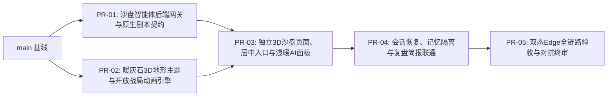

# 长征课《从于都到遵义》黎平独立 3D 沙盘推演与 AI 智能体 SDD + TDD + pstack 开发方案

- **版本**：v1.0（2026-11-28）
- **适用范围**：长征课《从于都到遵义》黎平站「进军方向」延伸出的独立 3D 战地沙盘推演页面与配套课堂 AI 网关能力（衔接[冻结落地方案](长征沉浸式VR党课落地方案.md#冻结版最高执行标准)与[AI 智能体架构与功能设计](长征课AI智能体架构与功能设计.md)）。
- **执行模式**：本文件为 **实施前蓝图（Plan Deliverable）**，遵循 pstack `multi-phase-plan` 规范；**当前按蓝图实施与验收，各波次以验收记录为准**。

---

## 0. 已确认需求裁决与红线约束

本方案依据需求访谈（`/in-your-own-words` 与 `/grill-me` 全分支收敛）固化全部边界，严守“单屏极简、防视觉疲劳、AI 原生开放推演、史实口径受控”的工程红线：

| 议题 | 裁决结论 | 设计红线 |
| --- | --- | --- |
| 入口位置与离线策略 | **两路线按钮正中入口；离线严格隐藏** | 在黎平「进军方向」页 `.tabletop-deck` 中，将「沙盘推演」按钮居中放置在「推演原计划 · 湘西北」与「推演新方向 · 贵州北部」之间；未连接本机 AI 网关（纯离线双击 HTML）时保持隐藏；点击后跳转至独立全屏 3D 沙盘页面，并提供返回「进军方向」页的入口。 |
| 视觉定调与防视觉疲劳 | **暖灰石建筑素模地形 + 浅暖半透明 UI** | 采用博物馆建筑素模浮雕 3D 地形（以暖宣素模为骨、整体略压暗为低反光暖灰石色调，缩小从暗色正课切入时的明暗反差），配极细墨灰高程等高线、淡墨江河水脉与四边地理标尺刻度；态势线用贴合地形起伏的古铜鎏金主线与朱砂细虚线及柔和呼吸点阵势场，禁止生硬卡通人物/兵棋图标及刺眼霓虹特效；右侧 AI 推演栏与左下视角控件采用浅暖半透明磨砂（深墨文字 + 暖金细边）融进地形底色。 |
| 战前初始底图与自由视角 | **1934.12 黎平战前制图底图** | 进入沙盘后镜头缓推聚焦湘桂黔战区，以克制的制图语言呈现黎平集结点呼吸锚点、湘江经通道至黎平的淡隐来路、湘西北敌军重兵封锁带柔和点阵势场，以及猴场、乌江、遵义等关键地标；全程支持拖动旋转、滚轮缩放、俯视/斜视切换与视角重置。 |
| AI 原生开放推演 | **废除固定路线模板，逐轮现场编排 3D 剧本** | 取消后端固定 4 条 `TRAJECTORY_VECTORS`，改为每次推演由 AI 参考真实湘桂黔地标经纬度表，按学员任意开放输入现场生成 1 至 3 路红军分队航点（主力、佯攻、分兵、固守等）、敌军动态拦截或合围箭头、分阶段推进动画、态势区域与自动镜头运镜；超出图幅的方向推至对应边界并说明地理与兵力约束；推演结论严守党史事实库并对照历史抉择，末尾提供「对照真实黔北路线」「重播推演」快捷操作卡。 |
| 自动联动与连续演进 | **流式文字同步驱动 3D 运镜与动画，多轮连续态势** | AI 流式输出推演分析的同时自动触发 3D 运镜与矢量动画；未点击「回档」或「还原」时，下一轮输入默认承接当前地图已经发生的战局场景继续推演。 |
| 智能体 UI 与架构对齐 | **右侧默认展开，完整复用「行迹副导」前后端架构** | 进入沙盘页默认展开右侧浅暖半透明 AI 推演栏（支持一键收起到右上角按钮），同屏隐藏全课通用「行迹副导」按钮避免出现双对话框；完整对齐行迹副导的 NDJSON 流式协议、多轮历史、快捷方案、多行输入框与发送、TXT/MD/CSV/JSON 资料附件上传及后台上下文压缩分隔。 |
| 「回档 / 还原 / 清空」三按钮 | **职责分离，语义明确** | **回档**：按快照栈平滑撤回上一步 3D 推演动效与态势，聊天区对用户完全不变且不插入可见系统消息，只在后台将回档后的最新态势静默同步给 AI；**还原**：弹窗确认后将整个 3D 地图重置回 1934.12 黎平初始态势（并静默通知 AI 从原点重新推演），保留历史对话记录方便对比；**清空**：弹窗确认后清空全部沙盘对话历史并同步还原地图。 |
| 会话生命周期与断连处理 | **课内全程保留；记忆独立；事件入账本；断连驻留提示** | 返回「进军方向」再重进或刷新页面均恢复对话、3D 态势与回档栈，直到点击「清空」或首页重「开始授课」；沙盘对话记忆与「行迹副导」完全隔离互不串台，推演记录同步写入课堂事件账本供课尾「实训复盘简报」使用；若在沙盘页中网关中途断开，留在当前页面提示连接中断并暂停发送，不强制退回。 |

### Antigravity × pstack 运行规则（强制）

1. **先读适配层与工作规约**：在本项目启动任何 pstack 委托任务时，子代理启动提示词首行必须显式要求先读取 pstack 插件目录中的 `skills/poteto-mode/worker.md` 与 `skills/pstack-harness-adapter/SKILL.md`。
2. **原生角色与思考档位**：通过原生 `invoke_subagent` 派发任务，按角色选用 `poteto-agent`（实现与重构）、`pstack-researcher`（只读探索与核验）、`pstack-reviewer` / `pstack-reviewer-alt`（对抗审查与验收复核）、`comment-sicko`（提交前注释审查）；按[仓库指南](../../AGENTS.md)显式指定 `reasoning_effort: high` 或更高档位，且同模型双席不得伪称为跨模型面板。
3. **隔离与合并边界**：仅对修改文件互不重叠的独立 PR 使用 `Workspace: "branch"` 并行；合回前先收回补丁并执行完整构建与验收检查，未经明确指示不擅自推送或覆盖未提交工作。
4. **过程决策留痕**：跨 PR 实施启用 `/show-me-your-work`，按 `timestamp | pr | decision | why | evidence | result` 格式记录于 `.march-build/liping-3d-sandbox/decisions.tsv`。

---

## 第一层｜SDD 需求规格与白话验收（What & Why）

### 1.1 需求规格清单（S-01 至 S-08）

| 需求 ID | 名称 | 核心规格 | 所属 PR |
| --- | --- | --- | --- |
| **S-01** | 入口居中与独立沙盘路由 | 「进军方向」页 `.tabletop-deck` 顺序调整为「推演原计划 · 湘西北」→「沙盘推演」→「推演新方向 · 贵州北部」；离线隐藏；点击进入独立全屏 3D 沙盘视图 `{ kind: 'sandbox', returnPosition, variant }`，顶部「返回进军方向」可原位回到进军方向页。 | PR-03 |
| **S-02** | 暖灰石建筑素模 3D 地形 | 在现有 WebGL 地形表面复用同一份高程数据切换 `'sandbox'` 渲染主题：暖灰石建筑素模漫反射、山谷环境光遮蔽、高程等高线、淡墨江河水脉与四边地理标尺刻度；离页切回 `'overview'`，保证首页绿色地形零变化且不增加大资源内存。 | PR-02 |
| **S-03** | 1934.12 战前初始态势底图 | 进入沙盘后镜头缓推至湘桂黔战区；以柔和制图线条显示湘江→通道→黎平来路淡痕、黎平集结点呼吸锚点、湘西北敌军重兵封锁带柔和点阵势场、以及猴场/乌江/遵义核心地标；随时支持拖拽旋转、滚轮缩放、俯/斜视切换与重置视角。 | PR-02、PR-03 |
| **S-04** | AI 原生多路 3D 战局编排 | 后端取消固定 4 条路线，提供湘桂黔 20+ 真实城镇/关隘经纬度参照表与地理围栏校验；AI 针对每次输入现场产出结构化 3D 战局剧本（含 `mode`、1–3 路红军分队航点、敌军阻击/合围矢量、分阶段推进动画、态势区、自动运镜与 `outOfBoundsNote` 边界说明），严守[权威党史事实库](../../课堂演示/harness/archive-knowledge.mjs)。 | PR-01、PR-02 |
| **S-05** | 流式联动、连续演进与对照操作 | 通过 NDJSON 流式返回推演文字与最终 `plan`；首包到达即同步展示推理文本，完成后立即驱动 3D 地图运镜并分阶段演绎动效；下轮默认承接当前地图已发生的态势继续推演；每轮结果卡底部附「对照真实黔北路线」「重播推演」快捷动作卡。 | PR-01、PR-02、PR-03 |
| **S-06** | 行迹副导式浅暖沙盘面板与附件 | 沙盘页默认展开右侧浅暖半透明磨砂 AI 栏（可收起至右上角触发键），同时隐藏全课通用「行迹副导」按钮；支持多轮对话历史、快捷方案预设、多行输入框与发送按钮、TXT/MD/CSV/JSON 资料附件上传（`<= 3` 份、`<= 4 KB`）及后台上下文压缩分隔条。 | PR-01、PR-03 |
| **S-07** | 「回档 / 还原 / 清空」状态控制 | **回档**：基于快照栈撤回上一步 3D 路线与动画至前一帧态势，对话界面保持用户视角原样无新增提示，仅后台随下轮请求静默传入 `actionSinceLastTurn: 'rolled_back'` 与当前态势摘要；**还原**：弹窗确认后回退地图至 1934.12 初始底图并静默通知 AI 从原点重演，保留对话历史；**清空**：弹窗确认后清除沙盘会话历史、摘要与快照栈，并将地图恢复初始态势。 | PR-01、PR-02、PR-03 |
| **S-08** | 会话恢复、记忆隔离与复盘联通 | 离开沙盘再进入或 `F5` 刷新后完整恢复当前沙盘对话、3D 最新态势与回档栈；点击「清空」或首页重「开始授课」后彻底重置；沙盘对话表/压缩摘要与「行迹副导」完全隔离，同时 `course_events`（`route: 'sandbox'`）持续入账供课尾「实训复盘简报」引用；网关断连时留在沙盘页提示并锁定发送，重连后自动恢复可用。 | PR-01、PR-03、PR-04 |

### 1.2 白话验收项（SM-01 至 SM-08）

| 验收 ID | 关联需求 | 真实操作与应看到的课堂结果 | 失败判据 |
| --- | --- | --- | --- |
| **SM-01** | S-01 | 离线直接打开成品 HTML 进入「进军方向」，桌面按钮组只见「推演原计划 · 湘西北」与「推演新方向 · 贵州北部」，无「沙盘推演」；通过一键开课连上网关进入「进军方向」，两按钮正中间出现「沙盘推演」；点击进入独立全屏 3D 沙盘页，点击左上返回回到「进军方向」。 | 离线仍显示沙盘按钮、按钮不在两路线正中、或点击仍弹出旧版桌面小浮窗。 |
| **SM-02** | S-02 | 在 3D 沙盘页与首页地图之间来回切换：沙盘页地形呈现低反光暖灰石素模、墨灰等高线、淡墨河道与边栏刻度，右侧面板与左下控件为浅暖半透明；返回首页后首页仍保持原深绿立体地形与原样样式。 | 沙盘与首页视觉雷同、高反光刺眼、文字在浅暖面板上对比度不足、或污染首页地形着色。 |
| **SM-03** | S-03 | 刚进入沙盘页未发送任何指令时，镜头自动推至湘桂黔战区，可见黎平集结点呼吸锚点、湘江经通道来路淡痕、湘西北重兵封锁带柔和点阵及猴场/乌江/遵义地标，全程无生硬人物兵棋；拖拽旋转、滚轮缩放、切俯/斜视与重置流畅响应。 | 进场一片空白、仍沿用人物/方块兵棋图标、或不能自由旋转缩放。 |
| **SM-04** | S-04 | 输入三条截然不同的非预设方案（例如“分出一支小分队佯攻通道吸引湘敌，主力绕道榕江向西南转移”“在黎平原地固守休整七天待机”“直接向正北渡过清水江直插沅陵”），每次生成的 3D 路线形状、分队数量、敌军拦截箭头方向、镜头落点与战地推演结论明显不同；若输入直向印度或太平洋进军等超图幅方向，路线推进至对应图幅边界并给出地理与兵力约束分析，绝不编造档案编号。 | 无论输入什么都只画出预设 4 条固定路径之一、分兵指令只画单线、或超图幅时坐标飘出画外/生成虚假史料。 |
| **SM-05** | S-05 | 提交方案后，右侧对话框即时流式显示分析文字，动画同步在 3D 地形上自动运镜并分段绘出红军行军与敌军拦截态势；回复完毕后出现「对照真实黔北路线」与「重播推演」卡片；紧接着输入“若刚才西路军再折向遵义南翼”等追问，3D 地图直接承接上轮已绘路线继续演进。 | 文字流完地图仍静止、动画与文字矛盾、追问时无故清空上轮态势、或缺失真史对照按钮。 |
| **SM-06** | S-06 | 沙盘页右上无「行迹副导」按钮，右侧浅暖推演栏默认展开且可点击「收起」缩至右上角；点击曲别针添加一份 `.txt` 资料并提问，AI 能结合资料要点作出区分回应；多轮对话超阈值后出现上下文压缩分隔提示。 | 同屏出现两个 AI 对话框、无法收起右侧栏、或附件上传报错/失效。 |
| **SM-07** | S-07 | 连续推演两轮后点「回档」，3D 地图平滑撤回第 2 轮路线恢复第 1 轮态势，聊天区记录原封不动无系统插条；此时输入“换一路从锦屏往东北”，AI 从第 1 轮态势接续而非第 2 轮；点「还原」弹出确认窗，确认后 3D 地图回到 1934.12 黎平初态但聊天记录保留，下轮输入从黎平原点重演；点「清空」弹出确认窗，确认后对话清空且地图复原。 | 点回档弹出多余提示或污染聊天区、回档后 AI 仍按已撤回态势续演、还原把聊天记录一并抹除、或还原/清空未弹窗直接破坏现场。 |
| **SM-08** | S-08 | 沙盘推演两轮后返回「进军方向」再重进、或按 `F5` 刷新，对话记录、3D 最新态势与回档栈完整恢复；去往正课打开「行迹副导」可见彼此对话完全独立；走到「课堂回顾」打开「实训复盘简报」，可见本次沙盘推演轨迹被正确纳入；网关运行中停止服务进程，沙盘页原地保留历史与画面并给出断连提示、禁用发送，重启网关恢复可用。 | 切页或刷新丢失 3D 态势/回档栈、沙盘消息混入行迹副导、复盘简报丢失沙盘轨迹、或断连瞬间把讲师踢回上一页。 |

---

## 第二层｜工程契约与领域模型（`/architect` 先定型再实现）

### 2.1 前端页面路由、构建登记与状态所有权

- **视图扩展（[lesson-session.ts](../../课堂演示/src/lesson-session.ts)）**：
  ```ts
  type LessonView =
    | { kind: 'map' }
    | { kind: 'opening' }
    | { kind: 'review'; conclusionPage: boolean }
    | { kind: 'scene'; position: number; variant: LessonMode }
    | { kind: 'sandbox'; returnPosition: number; variant: LessonMode };
  ```
- **构建脚本登记（[build.mjs](../../课堂演示/build.mjs)）**：
  - `scriptNames` 在 `harness-bridge` 之后、`lesson-page` 之前登记新增模块 `'sandbox-stage'`、`'sandbox-page'`；CSS 合并数组新增 `'./src/sandbox-page.css'`；同步脚本总体积继续严控在 `< 20 MiB` 红线以内。
  - 若扩展 [page-policy.mjs](../../课堂演示/page-policy.mjs) / [Test/verify-presentation-policy.mjs](../../Test/verify-presentation-policy.mjs) 校验新增文件，确保全部文案保持简体中文且无违规说明标语。

| 状态域 | 唯一所有者模块 | 允许写入方 | 销毁 / 重置边界 |
| --- | --- | --- | --- |
| 地形主题切换（`overview` / `sandbox`） | [terrain.ts](../../课堂演示/src/terrain.ts) | `lesson-map.ts`、`sandbox-stage.ts` | 离开沙盘页时自动复位 `'overview'` |
| 3D 战局渲染与相机/矢量动画 | `课堂演示/src/sandbox-stage.ts`（新增） | `sandbox-page.ts` | `dispose()` 取消 pending `rAF` 与动画计时器 |
| 沙盘快照栈与静默同步标记 | `课堂演示/src/sandbox-stage.ts` + `sessionStorage` | `sandbox-page.ts` | `清空` 或 `beginLesson()` 清零；`还原` 复位栈顶为初始底图态 |
| 独立沙盘页与右侧浅暖面板 | `课堂演示/src/sandbox-page.ts`（新增） | `app.ts` / `lesson-page.ts` / `lesson-session.ts` | `releaseCurrentPage()` 触发页面释放与在途请求 `AbortController` |
| 沙盘流式请求与课堂事件账本 | [harness-bridge.ts](../../课堂演示/src/harness-bridge.ts) | `sandbox-page.ts` | 共用课堂 `sessionId`，按 `route: 'sandbox'` 独立收发与压缩 |

### 2.2 WebGL 地形双主题契约（[terrain.ts](../../课堂演示/src/terrain.ts)）

为避免新增高程纹理或第二个 WebGL 上下文带来显存翻倍与上下文丢失风险，复用现有单例 `TerrainSurface`：

```ts
type TerrainTheme = 'overview' | 'sandbox';

interface TerrainSurface {
  element: HTMLDivElement;
  ready: boolean;
  lost?: boolean;
  onChange: () => void;
  setTheme: (theme: TerrainTheme) => void;
  orient: (angle: TerrainAngle) => void;
  project: (point: Point) => Point;
  projectElevated?: (point: Point, lift?: number) => Point;
  captureFrame: () => HTMLCanvasElement | undefined;
}
```

- **着色器差异化（`terrain.ts` 片元着色器增加 `uniform float themeMix`）**：
  - `themeMix = 0.0`（`'overview'`）：保持现有深绿低地 / 暖褐高地 / 墨蓝水域渲染逻辑与色彩数值不变，确保首页与正课过渡零像素退化。
  - `themeMix = 1.0`（`'sandbox'`）：
    - **底色**：低反光暖灰石素模色带（山谷 `#8f887d` 柔和过渡至山脊 `#bdb5a7`，水域压淡为冷静灰墨 `#737975`），显著压低纯白反光以防止教室大屏眩光与视觉疲劳。
    - **蚀刻等高线**：在片元着色器中按高程标量 `height` 取等高步距做抗锯齿 `fwidth`/平滑梯度线，叠入极细浅墨灰度线（透明度约 16%–24%），随地形真实起伏自然贴合。
    - **柔和山谷环境遮蔽**：结合邻域高程差压暗深谷底，突出建筑素模雕塑体量感。

### 2.3 AI 原生 3D 战局剧本契约与地理围栏

彻底移除 [course-ai-server.mjs](../../课堂演示/harness/course-ai-server.mjs) 中写死 4 组坐标的 `TRAJECTORY_VECTORS`，升级为**开放坐标编排 + 后端几何/史实双围栏**：

```ts
type GeoPoint = [lon: number, lat: number]; // 有效图幅范围：lon [104.5, 118.5], lat [23.85, 30.65]

type SandboxMapActionMark = 'continue' | 'rolled_back' | 'restored';

type SandboxForcePath = {
  id: string;
  role: 'main' | 'feint' | 'flank' | 'hold' | 'historical-ref';
  label: string;                // 如 "主力西进黔北" / "通道佯攻分队" (<= 14 字)
  waypoints: GeoPoint[];        // 2..8 个贴合地势的经纬度航点
  phase: number;                // 所属动画阶段 0..2
  style: 'solid-gold' | 'dashed-vermilion' | 'dotted-slate';
  outcome: 'advance' | 'blocked' | 'stalled' | 'breakthrough';
};

type SandboxEnemyVector = {
  id: string;
  label: string;                // 如 "湘军第4路重兵合围" (<= 14 字)
  from: GeoPoint;
  to: GeoPoint;
  phase: number;
  posture: 'intercept' | 'encircle' | 'garrison';
};

type SandboxTacticalZone = {
  id: string;
  label: string;                // 如 "湘西北重兵封锁带" (<= 14 字)
  center: GeoPoint;
  radiusDeg: number;            // 0.18..1.35，超出钳位
  kind: 'enemy-blockade' | 'weak-gap' | 'rally';
  phase: number;
};

type SandboxMapPin = {
  label: string;
  point: GeoPoint;
  tone: 'neutral' | 'gold' | 'vermilion';
  phase: number;
};

type SandboxCameraCue = {
  center: GeoPoint;
  zoom: number;                 // 0.95..2.35
  azimuth: number;              // -38..38
  tilt: number;                 // 0..55
};

type SandboxScenePlan = {
  mode: 'simulate' | 'explain'; // simulate 绘出新战局动画；explain 仅运镜高亮讲解地形/敌情
  title: string;                // 战地推演短标题 (<= 24 字)
  analysis: string;             // 流式输出的战地推演分析（客观、纪实、有条件约束依据）
  riskLevel: 'critical' | 'high' | 'viable';
  historicalContrast: string;   // 与黎平会议真实决策的对照（<= 120 字）
  outOfBoundsNote?: string;     // 若方向超出湘桂黔图幅边界，说明边界落点与约束
  camera: SandboxCameraCue;
  phases: {
    caption?: string;           // 该阶段极简动态标注 (<= 20 字)
    durationMs: number;         // 900..2200
    redForces: SandboxForcePath[];
    enemyForces: SandboxEnemyVector[];
    zones: SandboxTacticalZone[];
    pins: SandboxMapPin[];
  }[];                          // 1..3 个演进阶段；explain 模式可为 1 阶段仅含 camera/pins/zones
  citedSourceIds: string[];
};
```

- **请求携带的隐式态势上下文（`SandboxTurnRequest`）**：
  ```ts
  type SandboxTurnRequest = {
    sessionId: string;
    proposal: string;
    attachments?: { name: string; text: string }[];
    mapContext: {
      revision: number;
      isInitial: boolean;
      actionSinceLastTurn: SandboxMapActionMark;
      activeSummary: string;    // 当前 3D 沙盘最新可见态势摘要（供 AI 承接或以回档/还原态重演）
      activeRoutes: { label: string; role: string; waypoints: GeoPoint[] }[];
      activeZones: { label: string; center: GeoPoint; kind: string }[];
    };
  };
  ```
- **后端地标参照表与地理围栏（[archive-knowledge.mjs](../../课堂演示/harness/archive-knowledge.mjs) + [course-ai-server.mjs](../../课堂演示/harness/course-ai-server.mjs)）**：
  - 在 `archive-knowledge.mjs` 导出湘桂黔关键地标经纬度参照表（涵盖于都、湘江/全州/兴安、桂林、通道、靖县、黎平、锦屏、榕江、从江、镇远、施秉、黄平、凯里、独山、猴场/瓮安、乌江、遵义、怀化、沅陵、桑植、永顺等约 22 个真实坐标），注入 `sandboxSystem` 系统提示，供 AI 自由组合、迂回插值与延伸。
  - 后端收到模型输出后执行强校验与钳位：`lon` 严格钳位至 `[104.5, 118.5]`、`lat` 严格钳位至 `[23.85, 30.65]`（越界点沿起点射线截断在安全边距内，并在 `outOfBoundsNote` 未填时自动补齐边界说明）；限制最多 3 阶段、单阶段红军路径不超过 3 条、单条航点 2–8 个；`citedSourceIds` 经 `verifiedSourceIds()` 过滤。

### 2.4 沙盘智能体后端端点群与持久化（对齐行迹副导）

在 [course-ai-server.mjs](../../课堂演示/harness/course-ai-server.mjs) 新增与 `director` 对称的 4 个端点，与 `director` 共享同一套安全裁剪底座（[course-context.mjs](../../课堂演示/harness/course-context.mjs)），数据按 `route: 'sandbox'` 完全隔离：

| 端点 | 协议与职责 | SQLite 与内存隔离 |
| --- | --- | --- |
| `POST /api/course-ai/sandbox` | 若请求头含 `Accept: application/x-ndjson`，流式下发 `status` / `text`（实时流式呈现 `analysis`）/ `result`（完整校验后的 `plan`）/ `error`；不带流式头则返回兼容 JSON。接收 `attachments`（同 `directorAttachments` 校验）与 `mapContext`。 | 新增 `sandbox_turns (id, session_id, proposal, analysis, plan_json, interaction_id)` 表（带 `volatileSandboxTurns` 内存降级），并在 `course_events` 记入 `route: 'sandbox'`。 |
| `POST /api/course-ai/sandbox/history` | 读取当前 `sessionId` 的全部沙盘轮次（含用户提问、AI 分析文本、对应 `plan`）及 `compressionVersion`、`compressionTurnCount`。 | 仅查 `sandbox_turns` 与 `course_summaries(route='sandbox')`。 |
| `POST /api/course-ai/sandbox/compact` | 后台异步增量摘要压缩，仅汇总 `route === 'sandbox'` 事件，不影响 `director`。 | 同 `compactDirector` 竞态防重机制（`activeSandboxSessions` / `sandboxCompactions`）。 |
| `POST /api/course-ai/sandbox/clear` | 在同一事务中调用 `eventStore.clearRoute(sessionId, 'sandbox', through, ...)` 并清空 `sandbox_turns` 与在途压缩。 | 严禁触碰 `director_turns` 与其他 `route` 事件。 |

- **复盘简报天然联动**：[course-context.mjs](../../课堂演示/harness/course-context.mjs) 的 `ROUTES` 已包含 `'sandbox'`，`recap-report` 聚合事件时自动读取本场实际发生的沙盘输入、反事实后果与真实历史对照（标记 `classification: 'hypothesis'`）。

### 2.5 回档快照栈、还原与静默同步机制

前端在 `sandbox-stage.ts` 中维护只保存**纯态势快照**的回档栈（上限 24 步），严禁往用户可见聊天列表写入任何「已回档/已还原」假气泡：

```ts
type SandboxMapSnapshot = {
  readonly revision: number;
  readonly isInitial: boolean;
  readonly summary: string;
  readonly camera: SandboxCameraCue;
  readonly plan?: SandboxScenePlan; // undefined 代表 1934.12 黎平战前初态
};

type SandboxSnapshotState = {
  readonly stack: readonly SandboxMapSnapshot[];
  readonly pendingMarker: SandboxMapActionMark; // 'continue' | 'rolled_back' | 'restored'
};
```

```mermaid
sequenceDiagram
  participant User as "学员/讲师"
  participant UI as "沙盘对话栏 (可见记录)"
  participant Stage as "3D沙盘引擎 & 快照栈"
  participant Server as "课堂AI网关 (/api/course-ai/sandbox)"

  User->>UI: "第1轮输入：分兵佯攻通道，主力西出榕江"
  UI->>Stage: "读取栈顶 (isInitial=true, mark='continue')"
  UI->>Server: "POST { proposal, mapContext }"
  Server-->>UI: "NDJSON 流式 text + result(plan1)"
  UI->>Stage: "入栈 snapshot(rev=1, plan1) 并播放3D动画; mark='continue'"

  User->>UI: "第2轮输入：主力继续北渡乌江直逼遵义"
  UI->>Server: "POST { proposal, mapContext(rev=1, mark='continue') }"
  Server-->>UI: "NDJSON 流式 text + result(plan2)"
  UI->>Stage: "入栈 snapshot(rev=2, plan2) 并演进3D动画"

  User->>Stage: "点击顶部「回档」（不弹窗）"
  Stage->>Stage: "出栈回到 snapshot(rev=1); 平滑撤回plan2动效; mark='rolled_back'"
  Note over UI: "用户聊天记录保持原样，不插入系统通知"

  User->>UI: "第3轮输入：改道向北试探清水江"
  UI->>Server: "POST { proposal, mapContext(rev=1, mark='rolled_back', plan1摘要) }"
  Note over Server: "Prompt静默告知AI：用户已撤回后续推演，以当前rev=1地图为起点续演"
  Server-->>UI: "NDJSON 流式 text + result(plan3)"
  UI->>Stage: "入栈 snapshot(rev=3, plan3) 并播放新动画; mark='continue'"
```

- **「还原」确认态**：弹窗确认后调用 `stage.restoreToInitial()`，清空回档栈中非初态记录并重置回 `revision = 0, isInitial = true, pendingMarker = 'restored'`；聊天记录保留且不新增气泡；下一轮提问携带 `actionSinceLastTurn: 'restored'` 静默告知模型以 1934.12 黎平初态重演。
- **「清空」确认态**：弹窗确认后执行 `POST /api/course-ai/sandbox/clear` + 重置快照栈回初态 + 清空聊天面板并聚焦输入框。

---

## 第三层｜TDD 红绿闭环与三重验收矩阵（Unit + Live + Perf）

遵循 pstack `/tdd` 与 `principle-test-behavior-not-implementation`：**每项 PR 均须先编写可复现失败的红测（Red）并留存失败日志，再编写根因实现直至全绿（Green）**。

| 验收 ID | 工程验收条件（AC） | 自动化测试 / 实测脚本（T） | 红测前置方法（Red） | 性能 / 质量量化红线（Perf & Policy） |
| --- | --- | --- | --- | --- |
| **AC-S01** | 离线构建产物进入「进军方向」无沙盘按钮且零网关请求；连接网关时「沙盘推演」位于 `direction-east` 与 `direction-west` 正中；点击进入独立沙盘视图并可往返。 | 新增 `Test/verify-sandbox-e2e.py`（入口位置序数与隐藏态用例）+ 复用 `Test/verify-harness-e2e.py` | 先写 DOM 按钮坐标序数断言（`x(east) < x(sandbox) < x(west)`）与独立页根节点断言，对现有代码运行必红。 | 严禁破坏既有「推演原计划」「推演新方向」滑块与按键测试。 |
| **AC-S02** | `terrain.setTheme('sandbox')` 切换暖灰石素模、等高线与淡墨水脉后 `webgl` 无错误、显存不新增纹理副本；切回 `'overview'` 首页像素色值与基线一致。 | 新增 `Test/verify-sandbox-stage.mjs`（WebGL shader 编译/themeMix 状态与离页复位断言）+ 视觉截图核对 | 先写主题切换后返回首页对比像素差异断言与无残留 uniform 状态测试。 | 双主题复用同一 `elevation` 纹理，显存零新增纹理，首屏加载 `< 20 MiB` 预算保持。 |
| **AC-S03** | 沙盘进场无任何输入时自动聚焦湘桂黔战区并渲染黎平锚点、来路淡痕、湘西北点阵势场与猴场/乌江/遵义地标；支持拖拽旋转、滚轮缩放、俯/斜视切换、重置视角。 | `Test/verify-sandbox-e2e.py`（战前底图 SVG/锚点/标尺存在性、指针拖拽与滚轮相机变换测试） | 对空白容器断言黎平战前底图元素与相机旋转响应，未实现前全红。 | 连续拖拽无 Forced Reflow，地图缩放与旋转帧率 `>= 55 fps`。 |
| **AC-S04** | `course-ai-server.mjs` 支持开放 `SandboxScenePlan`（1–3 阶段、红军多路、敌军箭头、区域、运镜）；任意越界经纬度均被围栏钳位至安全边框并带 `outOfBoundsNote`；`citedSourceIds` 严格白名单过滤。 | 新增 `Test/verify-sandbox-agent.mjs`（Schema 校验、多路编排、越界钳位、党史白名单、mock 多样性测试） | 先写越界经纬度 `[140, 50]` 钳位与多路分兵输出校验用例，对旧版固定 `TRAJECTORY_VECTORS` 必红。 | 结构化输出 100% 通过校验，不降级为关键字硬编码。 |
| **AC-S05** | `POST /api/course-ai/sandbox` 支持 NDJSON 流式输出 `status/text/result`；前端流式期间即时更新回复文本，完成后自动触发 3D 运镜与分阶段矢量动画；支持「对照真实黔北路线」「重播推演」操作卡。 | `Test/verify-sandbox-agent.mjs`（NDJSON 流解析与取消）+ `Test/verify-sandbox-e2e.py`（流式上屏与多阶段动画状态 `data-phase` 推进） | 先对旧版非流式端点发 `Accept: application/x-ndjson` 断言流式分块到达（必红）。 | 流式首包增量渲染无布局抖动；动画阶段按预期完结并支持重播。 |
| **AC-S06** | 沙盘页隐藏通用「行迹副导」按钮；右侧浅暖推演栏默认展开、可收起/再展开；支持多轮历史、预设芯片、多行输入与 `<= 3` 份/`<= 4 KB` 资料附件上传及后台压缩分隔条。 | `Test/verify-sandbox-agent.mjs`（附件校验、历史、压缩接口）+ `Test/verify-sandbox-e2e.py`（面板收放、附件上传与双面板互斥断言） | 先写「行迹副导」隐藏断言与 `/api/course-ai/sandbox/history`、`compact` 接口测试（必红）。 | 无任何多余操作提示文案；通过 `node "Test/verify-presentation-policy.mjs"` 与 UI 规范对比度核验。 |
| **AC-S07** | 点「回档」撤回上步 3D 态势且聊天 DOM 子节点数与文本零变化，下轮请求 `mapContext.actionSinceLastTurn === 'rolled_back'`；点「还原」弹窗确认后地图复原、对话保留、下轮 `actionSinceLastTurn === 'restored'`；点「清空」弹窗确认后调 `/sandbox/clear` 清对话且不误删 `/director/history`。 | `Test/verify-sandbox-stage.mjs`（快照栈状态机单测）+ `Test/verify-sandbox-e2e.py`（三按钮真实点击、弹窗取消/确认分支与请求体抓包断言） | 先写快照栈 `push -> rollback -> restore -> clear` 契约单测与聊天区零污染断言，未实现前全红。 | 快照栈每步切换 `< 16 ms`，`rollback` 绝对零可见系统消息注入。 |
| **AC-S08** | 离开沙盘回「进军方向」再重进、或刷新页面均恢复对话、最新 3D 态势与回档栈；「行迹副导」与沙盘记忆完全隔离；「实训复盘简报」可见沙盘记录；网关断连后留在沙盘页显示断连提示并禁用发送，恢复网关后可继续推演。 | `Test/verify-sandbox-e2e.py`（刷新恢复、往返保留、副导隔离、简报引用、中途杀网关驻留提示全流程）+ 全量回归 `Test/verify-course-ai.mjs`、`Test/verify-director-context.mjs`、`Test/run-course-ci.py` | 先写跨页/刷新恢复断言、记忆隔离断言与断连不跳转断言（必红）。 | 纯离线模式下网络请求数严格为 `0`；全量回归无新增超时或失败。 |

---

## 第四层｜pstack 编排与分 PR 实施清单

遵循 pstack `multi-phase-plan` 与 `principle-sequence-verifiable-units`，将全部实现拆分为 **5 个可独立验收、文件边界清晰的 PR**，按 **4 个波次** 推进：

### 4.1 依赖图与并行波次



- **Wave 1（独立 `branch` worktree 并行）**：`PR-01`（纯网关与后端测试）与 `PR-02`（独立前端地形主题扩展、沙盘动画引擎与单测）改动文件零重叠，可并行执行。
- **Wave 2（串行集成）**：`PR-03`（合入 PR-01 与 PR-02 后构建独立沙盘全屏页面、调整进军方向按钮与浅暖沙盘 AI 栏）。
- **Wave 3（持久化与全课贯通）**：`PR-04`（跨页与刷新恢复、与行迹副导隔离校验、复盘简报验证及网关断连驻留）。
- **Wave 4（总验收与终审）**：`PR-05`（正式构建、`verify-long-march-course` 实机多视口验收、`/interrogate` 对抗审查与 `comment-sicko`）。

---

### 4.2 逐 PR 实施与验收卡片

#### PR-01｜后端沙盘智能体网关、流式协议与 AI 原生 3D 剧本契约
- **pstack 编排**：`/architect`（冻结 `SandboxScenePlan`、`SandboxTurnRequest` 与 `/sandbox/*` 端点）→ `/tdd` → `poteto-agent` 实现 → `/interrogate`（对抗审查地理越界、JSON 畸形输出、史料幻觉与两路由清空隔离）
- [ ] **依赖**：`main`
- [ ] **允许触碰文件**：
  - `课堂演示/harness/archive-knowledge.mjs`
  - `课堂演示/harness/course-context.mjs`
  - `课堂演示/harness/course-ai-server.mjs`
  - `Test/verify-sandbox-agent.mjs`（新增）
  - `Test/verify-course-ai.mjs`（仅在需要同步既有沙盘接口断言时更新）
- [ ] **唯一变更目标**：用湘桂黔真实地标坐标参照表与开放 `SandboxScenePlan` 取代固定 4 条 `TRAJECTORY_VECTORS`；实现 `/api/course-ai/sandbox`（NDJSON 流式 + 附件 + 隐式 `mapContext` 感知）及 `/history`、`/compact`、`/clear` 与 `sandbox_turns` 表；在服务边界强行钳位越界坐标、过滤 `citedSourceIds` 并保底党史严谨性；保持与 `director` 记忆完全隔离。
- [ ] **可见结果**：通过 `Test/verify-sandbox-agent.mjs` 与 `--mock-harness` 实测，不同开放输入能稳定生成流式文本与差异化的多路/多阶段 3D 战局 JSON，越界坐标自动钳位并附边界约束说明。
- [ ] **Unit 验证**：`node "Test/verify-sandbox-agent.mjs"`、`node "Test/verify-course-ai.mjs"`、`node "Test/verify-course-context.mjs"` 先红后绿。
- [ ] **Live / Perf 验证**：开启 `--mock-harness` 及真实配置端点实测 `/api/course-ai/sandbox` 流式首包响应、`compact` 增量摘要与 `/clear` 事务回滚；耗时控制在 `course-ai-server` 单轮超时预算内。

**PR-01 实施记录（2026-11-28）**

- 旧网关用沙盘流式请求运行新专项时，返回 HTTP 502，未能交付开放剧本。实现后专项覆盖增量文字、开放剧本、越界裁剪、来源白名单、附件、网关重启恢复、清空事务回滚、迟到请求及摘要竞态。
- 学员发起的课堂事件仍由课件按其顺序号同步，网关以同一交互 ID 保存校验后的沙盘剧本。SQLite 沙盘对话与摘要单独清理。前端通过当前地图摘要传入回档和还原状态。
- 沙盘预留 4200 输出 Token。未配置 `context.inputLimit` 时，沙盘采用 20000 的保守输入上限，其他入口沿用 16000。输入仍受已配置的模型窗口和安全余量约束。沙盘历史只提取教学所需的提问、反馈和部分状态标记，原始记录仍按 ID 可查。
- 专项命令为 `node "Test/verify-sandbox-agent.mjs"`。添加 `--live` 调用本机真实模型，独立记录首段文字延迟、总耗时、上游用量和失败场景。课堂成品的 Edge 模拟验证复用 `Test/verify-sandbox-frontend-e2e.py`。
- 真实模型分轮通过分兵、固守、正东出图三个场景。通过的样本首段文字分别为 10.4 秒、15.1 秒和 15.8 秒，总耗时分别为 14.8 秒、19.3 秒和 20.9 秒。其他尝试出现上游错误、输出截断或超时。真实摘要测试分别触发 5 秒超时和上游错误，两个场景均保留历史且版本未推进。SQLite 正常压缩、压缩防重、异常中止和事务隔离由可控上游专项验证。

**沙盘后端可靠性复验（2026-11-28）**

- 模型先流式返回分析，再输出必要路线与标记。网关补齐动画字段。默认向上游请求预留 2600 输出 Token，实际上游用量另行记录。对于完整 JSON 后的断流，按原 Schema 核验后提交。剧本不完整且预算、时限允许时最多重新生成一次，两次合计上限 56 秒。
- 后台摘要与推演分开调用，使用短编号引用原交互。网关校验后才写入真实事件 ID、覆盖范围和 SQLite 版本。模型遗漏的轮次仍保留在可选历史中。默认沙盘摘要时限为 26 秒，可用 `context.sandboxSummaryTimeoutMs` 覆盖。超时不会推进覆盖范围。
- 最终版本在同一课堂连续完成五轮。分兵、固守、黔北续推、改道黄平、解释对照的首段文字分别为 17.47、8.32、12.79、11.57、14.93 秒，完成时间分别为 19.09、14.17、24.63、18.04、21.09 秒。第 4、5 轮后分别用 5.66、9.63 秒提交摘要 v1、v2。SQLite 可读回五轮；最终摘要引用了原始事件，未继续引用的旧轮重新进入可选历史。较早复跑仍见上游超时，保留原始记录及已提交摘要。
- `node "Test/verify-sandbox-agent.mjs" --live` 使用本机模型。验收会话降低触发阈值以在五轮内覆盖压缩。输出包含首段文字、完成时间、流式分段、模型用量、摘要版本和证据回查结果。

#### PR-02｜暖灰石 3D 素模地形着色主题与 3D 战局矢量动画引擎
- **pstack 编排**：`/architect`（冻结 `TerrainSurface.setTheme`、`SandboxStage` 与 `SandboxSnapshotStack`）→ `prototype`（实机核对暖灰石像素与等高线疏密防视觉疲劳）→ `/tdd` → `poteto-agent` 实现 → `/benchmark-checklist`（核实 `rAF` 帧率与零新增显存）
- [ ] **依赖**：`main`
- [ ] **允许触碰文件**：
  - `课堂演示/src/terrain.ts`
  - `课堂演示/src/sandbox-stage.ts`（新增）
  - `Test/verify-sandbox-stage.mjs`（新增）
- [ ] **唯一变更目标**：为 `TerrainSurface` 增加零拷贝 `'sandbox'` 暖灰石素模与蚀刻等高线/淡墨水系渲染主题（离页稳态复原 `'overview'`）；新建 `sandbox-stage.ts` 实现 1934.12 黎平战前制图底图（呼吸锚点、淡隐来路、点阵封锁带、标尺刻度、关键地标）、多阶段 AI 3D 矢量路径/敌军拦截箭头/态势区动画、自动镜头插值运镜、自由轨道旋转缩放、以及纯态势快照栈（`push` / `rollback` / `restore` / `clear`）。
- [ ] **可见结果**：独立挂载 `sandbox-stage` 时即可呈现压暗暖灰石建筑素模地形与完整战前底图，传入任意开放 `SandboxScenePlan` 可平滑运镜并分段演进路线与拦截态势，回档能无痕平滑退回前一帧状态。
- [ ] **Unit 验证**：`node "Test/verify-sandbox-stage.mjs"` 先红后绿，覆盖坐标投影、快照栈状态转移、`rollback` / `restore` 标记产生与异常边界。
- [ ] **Perf 验证**：确认未创建第二张高程贴图、拖拽与旋转下每帧 `rAF` 合并渲染且 `>= 55 fps`、切离视图后挂起定时器与 `rAF`。

#### PR-03｜独立 3D 沙盘全屏页面、居中入口与浅暖 AI 智能体面板
- **pstack 编排**：`feature` + `visual-parity` → `/tdd` → `poteto-agent` 实现 → `pstack-reviewer` 审查 UI 底色与可访问性 → **操作者交互与审美评审门禁**
- [ ] **依赖**：`PR-01`、`PR-02`
- [ ] **允许触碰文件**：
  - `课堂演示/src/sandbox-page.ts`（新增）
  - `课堂演示/src/sandbox-page.css`（新增）
  - `课堂演示/src/harness-bridge.ts`
  - `课堂演示/src/lesson-page.ts`
  - `课堂演示/src/lesson-session.ts`
  - `课堂演示/src/app.ts`
  - `课堂演示/src/style.css`
  - `课堂演示/build.mjs`
- [ ] **唯一变更目标**：在「进军方向」页 `.tabletop-deck` 中将「沙盘推演」按钮居中置于「推演原计划 · 湘西北」与「推演新方向 · 贵州北部」之间（离线继续隐藏）；点击进入独立全屏 3D 沙盘页并隐藏通用「行迹副导」；实现浅暖半透明磨砂右栏（默认展开可收起）与左下视角控制条；完整对齐行迹副导流式交互、快捷预设、多行输入框、附件上传、上下文压缩分隔，以及顶部「回档 / 还原（弹窗确认）/ 清空（弹窗确认）」、回复末「对照真实黔北路线 / 重播推演」操作卡与网关断连驻留提示。
- [ ] **可见结果**：讲师与学员点击居中「沙盘推演」后进入全新暖灰石 3D 战地沙盘全屏页面，可在右侧浅暖面板自由输入/传资料与 AI 连续推演，实时观看 3D 地图自动运镜与态势动画，并随时回档、还原或清空。
- [ ] **Unit / Policy 验证**：`node "课堂演示/build.mjs" && node "课堂演示/build.mjs" --check`、`node "Test/verify-presentation-policy.mjs"`（无英文、无冗余引导语、同步脚本 `< 20 MiB`）。
- [ ] **Live 验证**：实机连网关打开沙盘页，对比暗色正课与暖灰石素模切页明暗反差、验证浅暖磨砂文字对比度与狭窗自适应（`1920×1080`、`1366×768`、`718×811`）。
- [ ] **操作者交互评审门禁（Review-Gated）**：由操作者实机体验入口布局、暖灰石压暗明度、浅暖右侧栏可读性及「回档/还原/清空」手感后放行合入。

#### PR-04｜会话持久化恢复、记忆隔离与课尾「实训复盘简报」联通
- **pstack 编排**：`/tdd` → `poteto-agent` 实现 → `/blast-radius`（验证跨页往返、刷新恢复、`beginLesson()` 清空、副导零串台与简报生成全链路）
- [ ] **依赖**：`PR-03`
- [ ] **允许触碰文件**：
  - `课堂演示/src/lesson-session.ts`
  - `课堂演示/src/sandbox-page.ts`
  - `课堂演示/src/harness-bridge.ts`
  - `Test/verify-sandbox-e2e.py`（新增）
- [ ] **唯一变更目标**：将沙盘快照栈与视图位置纳入 `sessionStorage` 课内快照；保证从沙盘返回「进军方向」再重进或 `F5` 刷新后完整恢复对话、最新 3D 态势与回档栈；首页重「开始授课」后干净清空；验证沙盘与「行迹副导」在 SQLite / 浏览器快照 / 压缩摘要三层完全隔离，同时 `course_events`（`route: 'sandbox'`）驱动课尾「实训复盘简报」生成；验证网关中途停止服务时的原地断连提示与重连恢复。
- [ ] **可见结果**：整堂课内自由往返正课与 3D 沙盘进度零丢失，不干扰行迹副导，课尾简报准确汇总沙盘推演轨迹。
- [ ] **Unit / Live 验证**：`.\.march-build\project-audit-venv\Scripts\python.exe "Test\verify-sandbox-e2e.py"`（覆盖 SM-01 至 SM-08 全部交互与边界用例）先红后绿。

#### PR-05｜双态 Edge 全链路验收、多视口核验与对抗终审
- **pstack 编排**：遵循[长征课验收技能](../../.agents/skills/verify-long-march-course/SKILL.md) → `/interrogate`（pstack-reviewer / pstack-reviewer-alt 独立复核）→ `comment-sicko` → `/show-me-your-work` 证据结账
- [ ] **依赖**：`PR-04`
- [ ] **允许触碰文件**：
  - `Test/verify-harness-e2e.py`（如因进军方向按钮位置或沙盘流式化需同步预期）
  - `课堂演示/从于都到遵义-课堂演示.html`、`展示材料/成果展示/课堂预览.html`（由 `build.mjs` 重新打包交付成品）
  - `项目文档/长征课/长征课AI智能体架构与功能设计.md`（代码落地后同步更新已落地章节状态）
- [ ] **唯一变更目标**：执行正式单文件构建，跑通纯离线与在线双态端到端自动化验收、多视口真实 Edge 截图与几何零重叠检查，并完成对抗代码审查与注释清理。
- [ ] **可见结果**：正式单文件课件与成果预览与源码完全一致，全部自动化脚本、规则检查与实机截图核验全绿无告警。
- [ ] **全量验收门禁**：
  ```powershell
  node "课堂演示/build.mjs"
  node "课堂演示/build.mjs" --check
  node "Test/verify-presentation-policy.mjs"
  node "Test/verify-sandbox-agent.mjs"
  node "Test/verify-sandbox-stage.mjs"
  node "Test/verify-course-ai.mjs"
  node "Test/verify-director-context.mjs"
  .\.march-build\project-audit-venv\Scripts\python.exe "Test\verify-sandbox-e2e.py"
  .\.march-build\project-audit-venv\Scripts\python.exe "Test\verify-harness-e2e.py"
  .\.march-build\project-audit-venv\Scripts\python.exe "Test\run-course-ci.py"
  git diff --check
  ```

---

## 五、证据台账、构建约束与启动入口

1. **范围门禁**：每个 PR 合并前须运行 `node "Test/verify-lesson-scope.mjs" --base <PR起点SHA> --allow <本PR白名单文件>` 确认零越界改动。
2. **红绿留痕**：所有先红后绿测试日志、多视口对比截图与性能基线采集统一写入 `.march-build/liping-3d-sandbox/`（按 `pr-01`..`pr-05` 分子目录存放 `red/` 与 `green/`），决策台账写入 `.march-build/liping-3d-sandbox/decisions.tsv`。
3. **当前状态与启动方式**：本方案规格已定稿，按 `Wave 1（PR-01 + PR-02 并行）→ Wave 2（PR-03）→ Wave 3（PR-04）→ Wave 4（PR-05）` 顺序推进交付。
